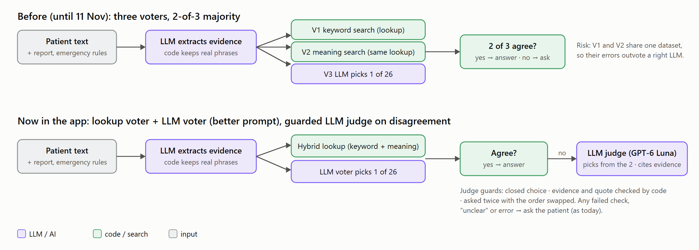
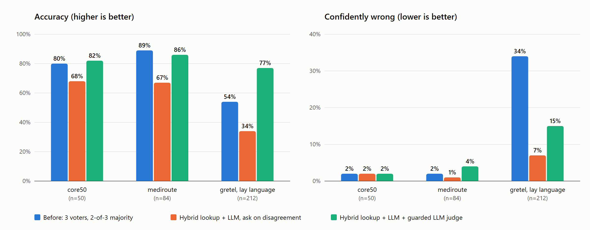
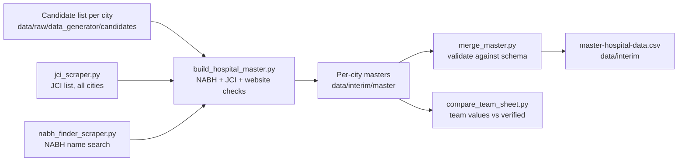

# MediRoute

**AI-assisted patient-to-hospital routing.** A patient describes their problem in plain language
(and can upload medical reports as PDFs). MediRoute works out the likely condition, the medical
specialty and the treatment needed, then recommends a **ranked, explained list of accredited
hospitals** with indicative costs.

> Capstone project, PG Program in AI/ML in Practice, IIT Bombay.

## Contents

1. [What problem does it solve?](#1-what-problem-does-it-solve)
2. [Architecture](#2-architecture)
   - [Step 1: Patient input to suggested speciality](#step-1-patient-input-to-suggested-speciality)
   - [Step 2: Specialty to ranked hospitals](#step-2-specialty-to-ranked-hospitals)
   - [Design choice: rules vs LLM](#design-choice-rules-vs-llm)
   - [Research basis](#research-basis)
   - [How the code maps to the architecture](#how-the-code-maps-to-the-architecture)
3. [Project structure](#3-project-structure)
4. [Setup](#4-setup)
5. [How to run](#5-how-to-run)
6. [How hospital data is extracted](#6-how-hospital-data-is-extracted)
   - [6.1 Sources](#61-sources)
   - [6.2 Pipeline](#62-pipeline)
   - [6.3 Where the data is kept](#63-where-the-data-is-kept)
   - [6.4 Data shared by Step 1 and Step 2, and the archive](#64-data-shared-by-step-1-and-step-2-and-the-archive)
   - [6.5 How to regenerate](#65-how-to-regenerate)
   - [6.6 Adding a city or hospital](#66-adding-a-city-or-hospital)
   - [6.7 Known limitations](#67-known-limitations)
7. [How to test](#7-how-to-test)
8. [Project tracker](#8-project-tracker)
9. [Disclaimer](#9-disclaimer)

---

## 1. What problem does it solve?

People who need specialist care, such as medical travellers and patients from smaller cities, often
don't know **which specialty** they need or **which hospital** is actually equipped for it. Today
this matching is done by human coordinators (Bookimed, Medmonks) or by opaque "AI matching" tools
that publish no evaluation.

MediRoute aims to be:

- **Accurate.** Three independent methods (keyword search, meaning search and a local LLM) must
  agree on the speciality, and every answer cites words from the patient's own text.
- **Transparent.** Hospitals are ranked by a deterministic, explainable method (AHP-TOPSIS), not
  by the LLM.
- **Grounded.** The LLM only *explains* results using the retrieved hospital records, so it can't
  invent hospitals.

## 2. Architecture


The pipeline has two steps, drawn top to bottom. Each step is marked as an **LLM** (purple),
**ML search** with embeddings, TF-IDF or FAISS (blue), or **deterministic code and rules** (green);
the right column lists the **data each step reads** (grey). Every LLM output is checked by code before
it is used (the ✔ lines). Input: English text and text-based PDFs (no OCR, no translation). The diagram is generated by
[`docs/architecture/make_architecture_diagram.py`](docs/architecture/make_architecture_diagram.py);
the earlier version is kept as
[`mediroute_pipeline_architecture_v1.png`](docs/architecture/mediroute_pipeline_architecture_v1.png).

**Algorithms in detail:** [`mediroute_algorithms.png`](docs/architecture/mediroute_algorithms.png) shows what each
stage computes: the algorithm, its weights and thresholds (read from the code), and one real worked example with
the LLM inputs and outputs, the lookup scores and the hospital bonuses. Generated by
[`docs/architecture/make_algorithms_diagram.py`](docs/architecture/make_algorithms_diagram.py). The admin page
shows the same numbers for every request (section "Step 1: how the speciality was worked out").

### Step 1: Patient input to suggested speciality

Step 1 does a hospital coordinator's routing job ("which department?"), not a doctor's job ("what
is wrong, what treatment?"). It outputs a **suggested speciality to search**, the words in the
patient's text that support it, and a disclaimer. API reference with examples and tracing:
[docs/api/step1_analyze_api.md](docs/api/step1_analyze_api.md).

| # | Stage | What it does | Type |
|---|-------|--------------|------|
| 1.1 | **Protect + emergency rules** | Remove phone numbers, e-mails and ID numbers. Fixed red-flag rules (chest pain with breathlessness, stroke signs, heavy bleeding, suicidal intent…) add an emergency notice; routing continues | Code |
| 1.2 | **Extract evidence** | The LLM copies conditions, procedures and body parts from the text; patient words from `specialty_mapping.csv` found in the text are added (weak words such as "baby" or "eye" only when no strong one is found) | LLM + code |
| 1.3 | **Clean evidence (data correction)** | Code corrects what the LLM returned before anyone votes: a phrase is kept only if it really appears in the text (typos allowed), and generic words (treatment, hospital, doctor, city names, "since last month") are dropped. Each dropped phrase is logged with the reason | Code |
| 1.4 | **Two voters** | **V1 lookup voter**: each evidence phrase is searched by keyword (TF-IDF) and by meaning (embeddings) in a lookup list of 10,884 terms (ICD-10-CM diagnoses grouped by AHRQ **CCSR**, CGHS procedures, patient lay terms, mapped by `specialty_mapping.csv`); the two result lists are fused by rank. Symptom and weak matches count half. **V2 LLM voter**: picks from the 26 specialities, reading each one's description and routing boundaries; code rejects any other name | Code / embeddings / LLM |
| 1.5 | **Agree, or the LLM judge decides** | Both voters agree → answer. They disagree → a **guarded LLM judge** (GPT-6 Luna) picks one of the two: closed choice, evidence and quote checked by code, asked twice with the order swapped; any failure → ask. No LLM → the lookup voter answers alone. General Medicine asks one question before it is accepted | Code + LLM |
| 1.6 | **Clarify, else user picks** | No answer: a short form (body area, existing diagnosis, recommended procedure), up to 2 rounds, then the user picks from the list | Code |
| 1.7 | **Trace** | Every stage of every request is logged with a `request_id` in `logs/step1_trace.jsonl` (input, LLM calls, votes, decision) | Code |

**Why the data-correction stage matters.** For *"eye infection since last 1 month, suggest
treatment hospital in Mumbai"* the LLM returned "treatment" and "hospital" as procedures. Both are
in the text, so the old check kept them, and the keyword voter matched them to Obstetrics &
Gynaecology lookup rows. ICD-10-CM and CGHS also use clinical wording ("conjunctivitis"), so "eye
infection" itself found no strong match. Two fixes: generic words are dropped from the evidence,
and patient lay terms from `specialties.csv` were added to the lookup list. The same query now
votes Ophthalmology (tests: `test_eye_infection_query_drops_generic_evidence`,
`test_generic_words_are_not_evidence`).

Measured through the API on 12 scenarios (`scripts/api_smoke_step1.py`): all routed as intended,
including report text, emergency notice, both clarification paths and the user's choice; about
11–20 s per request on a CPU laptop.

#### Evaluation and the adopted design



We benchmarked Step 1 on 346 gold messages (`scripts/benchmark_step1*.py`; LLM llama3.2 3B on
Ollama, judge GPT-6 Luna via OpenRouter). Accuracy counts a clarification question as not correct.



| Design | core50 acc / wrong | mediroute acc / wrong | gretel (lay language) acc / wrong |
|---|---|---|---|
| Keyword search only (baseline) | 86% / 14% | 88% / 12% | 68% / 32% |
| LLM only (baseline) | 76% / 16% | 81% / 18% | 73% / 26% |
| **Before:** 3 voters, 2-of-3 majority | 80% / 2% | 89% / 2% | 54% / 34% |
| Hybrid lookup + LLM, ask on disagreement | 68% / 2% | 67% / 1% | 34% / 7% |
| **Now:** lookup voter + LLM voter + guarded LLM judge | **82% / 2%** | **86% / 4%** | **77% / 15%** |

**Why we adopt it.** V1 and V2 search the same list, so their mistakes agree and can outvote a
correct LLM. Merging them and letting a stronger, guarded LLM judge settle disagreements keeps the
safety of asking (judge failures fall back to a question) and recovers most of the accuracy,
above all on lay language: 54% → 77% correct, 34% → 15% confidently wrong. The judge costs about
$0.0001 per disagreement. **Status:** in the app since 11 Nov 2026 (lookup voter + LLM voter +
LLM judge). Without an OpenRouter key the judge is skipped and disagreements ask a question.
Full report: [docs/evaluation/step1_benchmark_report.html](docs/evaluation/step1_benchmark_report.html).

**Step 1 → Step 2 in one call.** The frontend calls `POST /api/patient-routing`, a LangGraph
workflow (built by Shubham, integrated with Step 1): optional reports are parsed, Step 1 suggests the
speciality, and Step 2 ranks hospitals for it, or the flow returns a clarification (Step 1's form or
speciality list, a location question, or "no verified hospital yet"). Before/after and test results:
[docs/design/step1_step2_integration.md](docs/design/step1_step2_integration.md). Check all paths
with `python scripts/api_smoke_workflow.py`.

### Step 2: Specialty to ranked hospitals

What runs today (`hospital_recommendation/engine.py`, built by Shubham). Dashed boxes in the
diagram are planned, not built.

| # | Stage | What it does | Type |
|---|-------|--------------|------|
| 2.1 | **Hard filters** | Keep hospitals whose verified specialities include Step 1's speciality (hospital department names mapped by the `hospital` rows of `specialty_mapping.csv`), then the preferred city / state. None left: say no hospital has the speciality yet, or ask whether to search other cities | Code |
| 2.2 | **Semantic search** | Query = speciality + diagnoses + procedures + findings from Step 1. Cosine search (`multi-qa-MiniLM-L6-cos-v1`, FAISS) over the filtered hospitals only, keeping 3×K candidates | Embeddings |
| 2.3 | **Rerank: semantic + bonus** | Final score = semantic score + a rule bonus capped at 0.20: matched procedure up to 0.08, verified 0.03, NABH 0.02, JCI 0.02, international patient services 0.02, evidence quality up to 0.03. Each bonus is shown as a ranking reason | Code |
| 2.4 | **Result** | Top 5 hospitals with final score and reasons | Code |

Data: the index is built from [data/processed/hospitals.csv](data/processed/hospitals.csv), the one
hospital table Step 1 also reads (see [6.4](#64-data-shared-by-step-1-and-step-2-and-the-archive)).
A speciality confirmed on the hospital's website earns 0.04 and ranks above one only the team sheet
lists; procedures match by words ("CABG" finds "Robotic CABG"); a city searches its whole area
(Delhi NCR, Mumbai + Navi Mumbai). Known gaps: no Ophthalmology, ENT, Dermatology, Psychiatry or
General Medicine hospitals yet; the keyword retriever exists but is not used; the bonus weights are
fixed, not tested. Planned: AHP-TOPSIS
with tested weights (medical fit above location, per the TA), grounded LLM explanation per
hospital, CGHS cost for display only.

### Design choice: rules vs LLM

| Step | Rules / code | LLM | Our choice |
|------|--------------|-----|------------|
| 1. Input to specialty | Fast and predictable, but misses new wording and can't read free text | Handles paraphrase and reports, but can hallucinate | **Vote.** Two search methods and an LLM vote; code requires a majority plus evidence from the text, otherwise it asks |
| 2. Specialty to hospitals | Transparent and repeatable, but needs expert weights | Flexible but opaque, and may invent hospitals | **Code ranks (AHP-TOPSIS).** The LLM only explains |

### Research basis

| Source | Finding | Used for |
|--------|---------|----------|
| Bookimed, Medmonks | Human coordinators match hospitals per request | Human-coordinator baseline |
| Şahin & Cezlan, 2022 | AHP weights from 7 experts, then TOPSIS. Staff, care quality and equipment rank highest | AHP criteria template (Step 2) |
| Rules vs AI triage, 2024 | Both above 70% accuracy, with equal safety | Baselines in both steps |
| Grounded RAG triage | Accuracy 0.802 vs 0.542 for a plain LLM | Grounding the LLM in retrieved records |
| Rule-system review | Heavy manual programming, weak on nuanced language | Why Step 1 uses an LLM |

*Figures come from the papers' abstracts. Verify them against the full sources before citing.*

### How the code maps to the architecture

Each step of the architecture is its own package. The two packages never import each other.
They share only `common/` (the `MedicalContext` hand-off object) and `utils/`.

| Architecture stage | Module(s) in `src/mediroute/` |
|--------------------|-------------------------------|
| **Step 1** | **`specialty_routing/`** (API routes in `specialty_routing/api.py`) |
| Patient input + reports | `/api/analyze`, `/api/reports/parse`, `extraction/pdf_parser.py` |
| 1.1 Protect + emergency rules | `step1/protect.py`, `step1/safety.py` |
| 1.2 Extract evidence | `step1/evidence.py`, `prompts/evidence_v1.txt` |
| 1.3 Clean evidence | `step1/evidence.py` (`verify_phrase`, `is_generic`, `GENERIC_WORDS`) |
| 1.4 Voters | `step1/voters.py` (lookup voter, LLM voter), `step1/lookup.py` (lookup list + TF-IDF and embedding search), `prompts/specialty_v2.txt` |
| 1.5 LLM judge | `step1/judge.py` (`MEDIROUTE_JUDGE_PROVIDER` = openrouter / ollama / none, `MEDIROUTE_JUDGE_MODEL`) |
| 1.5–1.6 Decide, clarify, user choice | `step1/pipeline.py` |
| 1.6 Trace | `step1/trace.py` |
| Service + baselines | `service.py` (`MEDIROUTE_ROUTING_MODE`: `vote` default; `rules`, `llm`, `hybrid` for evaluation), `routes.py` |
| **Hand-off** | **`common/medical_context.py`** (`MedicalContext`) |
| **Step 2** | **`hospital_recommendation/`** (API routes in `hospital_recommendation/api.py`) |
| 2.1 Filter + retrieve | `specialty_filter.py`, `retrieval/` (FAISS, filtered FAISS, TF-IDF keyword, semantic query builder) |
| 2.2 Rank | `ranking/hospital_reranker.py`, `engine.py` (AHP-TOPSIS is planned) |
| App + orchestration | `backend/main.py` (assembles the FastAPI app); `backend/workflow/` (LangGraph graph: `parse_reports` → `step1_route` → `recommend_hospitals` → finalize / clarification; endpoint `/api/patient-routing` in `workflow/api.py`) |
| Hospital data (NABH, JCI) | `data_generator/` (scrapers, master-dataset and FAISS index builders) |

See [docs/PROJECT_TRACKER.md](docs/PROJECT_TRACKER.md) for what is done and what is pending.

---

## 3. Project structure

```
MediRoute/
├── src/mediroute/                 # Python package (src layout)
│   ├── specialty_routing/         # STEP 1: patient input → specialty
│   │   ├── api.py                 # /api/analyze, /api/medical-context, /api/reports/parse, /api/icd10/*
│   │   ├── step1/                 # Voting pipeline: protect, safety, evidence, voters, pipeline, trace
│   │   ├── prompts/               # Versioned LLM prompts (evidence_v1, specialty_v1)
│   │   ├── service.py, routes.py  # Mode switch (vote / rules / llm / hybrid) and baseline routes
│   │   ├── router.py              # Earlier router (rules → embeddings → LLM → zero-shot), not used by the API
│   │   ├── icd10_mapper.py        # ICD-10 ↔ condition ↔ specialty
│   │   ├── schemas.py             # PatientRequest (incl. reportText, clarification, selectedSpecialty)
│   │   └── extraction/            # PDF parser, context extractor, aggregator, validator
│   ├── hospital_recommendation/   # STEP 2: specialty → ranked hospitals
│   │   ├── api.py                 # /api/hospitals/*
│   │   ├── engine.py              # Filter → retrieve → rerank
│   │   ├── specialty_filter.py, hospital_loader.py
│   │   ├── schemas.py             # HospitalRecommendationRequest
│   │   ├── retrieval/             # FAISS, filtered FAISS, keyword, semantic query builder
│   │   └── ranking/               # Reranker (AHP-TOPSIS planned)
│   ├── common/
│   │   └── medical_context.py     # MedicalContext: the Step 1 → Step 2 contract
│   ├── backend/                   # FastAPI app assembly
│   │   ├── main.py                # Creates the app, CORS, includes both step routers
│   │   └── workflow/              # LangGraph workflow (graph, nodes, decisions, state) + /api/patient-routing
│   ├── data_generator/            # Offline pipelines that build the files in data/
│   │   ├── jci_scraper.py, nabh_finder_scraper.py        # Accreditation scrapers (Playwright)
│   │   ├── build_hospital_master.py                      # Verify candidates (NABH, JCI, website) per city
│   │   ├── merge_master.py, compare_team_sheet.py        # Build/validate master CSV; check team sheets
│   │   ├── build_hospitals_table.py                      # The one hospital table (master + team detail)
│   │   ├── validate_specialty_mapping.py                 # Check specialty_mapping.csv
│   │   ├── rebuild.py                                    # Rebuild every generated file in data/processed/
│   │   └── build_hospital_embedding_dataset.py, build_faiss_index.py   # Vector store
│   └── utils/
│       ├── paths.py               # Single source of truth for all project paths
│       └── logging_config.py      # Shared "mediroute" logger (file + console)
├── frontend/                      # Static HTML/CSS/JS UI (patient, results, hospital pages)
├── tests/
│   ├── specialty_routing/         # Step 1 tests
│   ├── hospital_recommendation/   # Step 2 tests
│   └── workflow/                  # Step 1 + Step 2 graph tests
├── data/
│   ├── processed/                 # THE ONLY FOLDER THE APP READS (section 6.4)
│   │   ├── specialties.csv        #   speciality master list (hand-maintained, reviewed)
│   │   ├── specialty_mapping.csv  #   every "X -> speciality" rule (hand-maintained, reviewed)
│   │   ├── cities.csv, hospital.schema.csv          # hand-maintained
│   │   ├── hospitals.csv, step1_lookup.csv          # generated
│   │   └── vector_store/          #   generated: Step 2 FAISS index + Step 1 embedding cache
│   ├── raw/                       # Official sources and team sheets, never edited
│   ├── interim/                   # Pipeline intermediates: JCI/NABH scrapes, per-city and merged verified master, id links
│   └── evaluation/                # Gold test sets and benchmark results (not read by the app)
├── archive/                       # Retired data files and scripts; README.txt says why and what replaced them
├── scripts/                       # restart_app.ps1, smoke and verification scripts
├── docs/                          # Architecture diagram, project tracker, API playground, references
├── pyproject.toml                 # Package metadata and dependencies
├── setup.py                       # Shim for legacy tooling
├── requirements.txt               # Runtime dependencies
└── requirements-dev.txt           # Plus scraping, test and lint tools
```

## 4. Setup

Requirements: **Python 3.10+** (developed on 3.14), Windows/macOS/Linux, and
[Ollama](https://ollama.com) with `llama3.2` (`ollama pull llama3.2`) for Step 1's evidence and
LLM voter.

**No Ollama? The app still runs.** If Ollama isn't installed or running, or the model isn't pulled,
the API prints a warning banner at startup and carries on: evidence comes from speciality keywords,
the LLM voter abstains, and the two search voters must agree. Each request logs
`LLM unavailable`, and the patient and results pages show a short notice. Calls are skipped
instantly (no waiting on a refused connection), and the server checks again every 60 s, so starting
Ollama later works without a restart. To turn the LLM off on purpose:

```powershell
$env:MEDIROUTE_LLM_PROVIDER = "none"   # default "ollama"
```

**No Ollama, but want the LLM? Use OpenRouter's free models.** Each teammate makes their own free
key (GitHub login, no card) at https://openrouter.ai/settings/keys, saves it once, and starts the
API with the OpenRouter provider:

```powershell
setx OPENROUTER_API_KEY "sk-or-v1-..."      # once; reopen VS Code / the terminal afterwards
# with the key set, Step 1 uses OpenRouter automatically ($env:MEDIROUTE_LLM_PROVIDER = "ollama" to force local)
# optional: $env:MEDIROUTE_OPENROUTER_MODEL = "model-a:free,model-b:free"  (tried in order)
```

Default models, tried in order: `dots-studio/dots-3-note-preview:free` (fastest in our comparison;
expires 31 Dec 2026), then `nvidia/nemotron-3.5-super-vl:free`. A model that is rate-limited
upstream or refuses is skipped for 60 s and the next one answers. Free tier:
**50 requests/day, 20/min**; each Step 1 request uses 2. Hidden "reasoning" is turned off (it was
~95% of the output and most of the wait; `MEDIROUTE_OPENROUTER_REASONING=on` re-enables it), and the
two calls run in parallel. Eye-infection query: 37.6 s (nemotron, reasoning on) → 14.8 s
(reasoning off, parallel; nemotron's free queue holds each call ~13 s) → **2.5 s with dots-3-note**.
Per call, the admin page shows "wait for first token" and which models were tried. If the limit runs out, Step 1 falls
back to the two search voters like the no-LLM mode. Send only synthetic test data. Never commit the
key.

The Step 1 lookup list (`data/processed/step1_lookup.csv`) is in the repo. To rebuild it,
download the CDC ICD-10-CM code descriptions (public domain) and run the rebuild (section 6.4):

```powershell
# ICD-10-CM 2026 order file -> data/raw/icd10cm_2026/extracted/ (not committed; ~23 MB)
Invoke-WebRequest "https://ftp.cdc.gov/pub/Health_Statistics/NCHS/Publications/ICD10CM/2026/icd10cm-Code%20Descriptions-2026.zip" -OutFile icd10cm.zip
Expand-Archive icd10cm.zip -DestinationPath data/raw/icd10cm_2026/extracted
python -m mediroute.data_generator.rebuild --step lookup
```

The embedding cache for the lookup list (`data/processed/vector_store/step1_lookup_embeddings_*.npy`) is
built on the first start (about 90 s) and reused afterwards.

```powershell
git clone https://github.com/shubhamgithhub/MediRoute.git
cd MediRoute

python -m venv .venv
.\.venv\Scripts\Activate.ps1          # macOS/Linux: source .venv/bin/activate

pip install -e ".[dev,scraping]"      # Editable install of the package plus dev tools
# or: pip install -r requirements-dev.txt; pip install -e . --no-deps

playwright install chromium           # Only needed for the scrapers
```

Optional environment variables:

| Variable | Default | Purpose |
|----------|---------|---------|
| `MEDIROUTE_DATA_DIR` | `./data` | Use a data folder in another location |
| `MEDIROUTE_LOG_DIR` | `./logs` | Where `mediroute.log` is written |
| `MEDIROUTE_HOST` / `MEDIROUTE_PORT` | `127.0.0.1` / `8000` | Used by the `mediroute-api` command |
| `OLLAMA_API_BASE_URL` | `http://127.0.0.1:11434` | Ollama server for Step 1 |
| `MEDIROUTE_ROUTING_MODE` | `vote` | Step 1 mode: `vote`, or the baselines `rules`, `llm`, `hybrid` |
| `MEDIROUTE_LLM_PROVIDER` | `openrouter` if `OPENROUTER_API_KEY` is set, else `ollama` | Step 1 LLM: `ollama`, `openrouter` (needs `OPENROUTER_API_KEY`) or `none` |
| `MEDIROUTE_LLM_MODEL` | `llama3.2` | Ollama model used by Step 1 |
| `MEDIROUTE_OPENROUTER_MODEL` | dots-3-note, then nemotron (free) | OpenRouter models, tried in order |
| `MEDIROUTE_LOG_PATIENT_TEXT` | `1` | `0` logs only a hash of the patient text. Set to `0` before any real patient data |

### Start the app (every time)

Open **two terminals** in the repo folder (VS Code: *Terminal → New Terminal*, twice).

**Terminal 1: backend API** (port 8000)

```powershell
.\.venv\Scripts\Activate.ps1
$env:PYTHONPATH = "src"

# pick ONE LLM option (skip this line for the default, local Ollama):
# $env:MEDIROUTE_LLM_PROVIDER = "openrouter"   # no Ollama: free hosted models, needs OPENROUTER_API_KEY
# $env:MEDIROUTE_LLM_PROVIDER = "none"         # no LLM at all: two search voters only

python -m uvicorn mediroute.backend.main:app --host 127.0.0.1 --port 8000
```

Wait until the log shows `Step 1 LLM warm-up done` (about 30 s; about 2 minutes on the very first
start while the embedding cache is built). With no LLM you see a `WITHOUT an LLM` banner instead,
and the app still works.

**Terminal 2: frontend** (port 5500)

```powershell
.\.venv\Scripts\Activate.ps1
python scripts/serve_frontend.py   # no caching: every reload shows the latest files
```

**Open in the browser**

| Page | URL |
|------|-----|
| Patient app | http://127.0.0.1:5500/index.html |
| Admin page (request history) | http://127.0.0.1:5500/admin.html |
| API docs | http://127.0.0.1:8000/docs |
| Health check | http://127.0.0.1:8000/api/health |

Stop either server with **Ctrl + C** in its terminal. Quick API check without the browser:
`python scripts/api_smoke_step1.py` (Step 1) and `python scripts/api_smoke_workflow.py` (Step 1 + 2).

## 5. How to run

**Backend API**

```powershell
mediroute-api
# or
python -m uvicorn mediroute.backend.main:app --reload --host 127.0.0.1 --port 8000
# or, on Windows: also restarts Ollama and writes logs
.\scripts\restart_app.ps1
```

- Interactive API docs: http://127.0.0.1:8000/docs
- Health check: http://127.0.0.1:8000/api/health
- At start-up Step 1 loads its lookup index and warms up the LLM in the background. Wait for
  `Step 1 LLM warm-up done` in `logs/mediroute.log` before the first request (about 30 s, or
  about 2 minutes on the very first start while the embedding cache is built).
- Try Step 1: `python scripts/api_smoke_step1.py` (12 scenarios), or see
  [docs/api/step1_analyze_api.md](docs/api/step1_analyze_api.md).
- **Admin page** (request history): http://127.0.0.1:5500/admin.html. Every request with its
  input, evidence, the three votes and their lookup matches, each LLM call (timings, tokens, raw
  output, prompt), the decision, what was served and the Step 2 outcome. Data comes from
  `GET /api/admin/requests` and `GET /api/admin/requests/{id}`, which read
  `logs/step1_trace.jsonl`. **No login yet:** it shows patient text, so keep the API on 127.0.0.1.

**Frontend**

The frontend is static and calls the API at `http://127.0.0.1:8000`.

```powershell
python scripts/serve_frontend.py
# open http://127.0.0.1:5500/index.html
```

**Main endpoints**

| Method | Path | Purpose |
|--------|------|---------|
| POST | `/api/patient-routing` | **End to end, used by the frontend:** optional PDFs + text + city (+ form answers) → Step 1 → Step 2 → ranked hospitals or a clarification (LangGraph workflow) — [integration notes](docs/design/step1_step2_integration.md) |
| POST | `/api/analyze` | Step 1 only: patient text (+ report text, form answers) to suggested speciality — [reference](docs/api/step1_analyze_api.md) |
| POST | `/api/reports/parse` | Upload PDF reports and extract text |
| POST | `/api/medical-context` | Build a structured medical context |
| POST | `/api/hospitals/recommend` | Medical context to ranked hospitals (Step 2) |
| POST | `/api/hospitals/semantic-recommendations` | FAISS semantic hospital search |
| GET | `/api/hospitals/search`, `/api/hospitals/keyword-search` | Location and keyword search |
| GET | `/api/icd10/map`, `/api/icd10/code/{code}` | ICD-10 lookups |

There are more request examples in [docs/API_TEST_PLAYGROUND.md](docs/API_TEST_PLAYGROUND.md).

**Data pipelines** (run from the repo root)

```powershell
# Hospital master data (NABH + JCI + official websites): see section 6 for the full steps
python -m mediroute.data_generator.build_hospital_master --candidates (Get-ChildItem data/raw/data_generator/candidates/*.csv) `
    --jci data/interim/jci/jci_all_cities.csv --out-dir data/interim/master
python -m mediroute.data_generator.merge_master

# Everything in data/processed/ that is generated: hospital table, Step 1 lookup, search indexes
python -m mediroute.data_generator.rebuild
```

## 6. How hospital data is extracted

The hospital master is built from **public, official sources only**. Each value is either checked
automatically or marked as a manual judgement. Every row carries the evidence behind it, such as a
certificate number, JCI ID, website status or source, so anyone can re-check it.

### 6.1 Sources

| Source | What we take from it | Link |
|--------|----------------------|------|
| NABH "Find a Healthcare Organisation" | NABH status, certificate number, certificate PDF, listed name and website | [nabh.co/find-a-healthcare-organisation](https://nabh.co/find-a-healthcare-organisation/) |
| JCI accredited organisations (India) | JCI status, IHCO ID, listed website | [jointcommission.org: JCI-accredited organisations](https://www.jointcommission.org/en/about-us/recognizing-excellence/find-accredited-international-organizations) |
| Each hospital's official website | Whether the site loads, the international-patients page, specialties | `official_source_url` column |
| Team workbook (one sheet per person) | Candidate hospitals, tiers, type, ownership | [Hosp_Data_Final.xlsx](data/raw/data_generator/Hosp_Data_Final.xlsx) |
| Speciality mapping | Normalises website wording to canonical specialties (`hospital` rows) | [specialty_mapping.csv](data/processed/specialty_mapping.csv) |

Please read the [NABH terms and conditions](https://nabh.co/terms-and-conditions/) before
running the scrapers. The scrapers identify themselves with a contact email, wait between requests,
check `robots.txt`, and run one browser at a time.

### 6.2 Pipeline



1. **Candidate list.** One CSV per city in
   [data/raw/data_generator/candidates/](data/raw/data_generator/candidates/), one row per hospital.
   It holds the manual fields (`City_Tier`, `Hospital_Tier`, `hospital_type`, `ownership_type`) and
   lookup hints:
   - `nabh_query`: the word to search on NABH, e.g. `MIOT` (NABH lists "MIOT Hospitals").
   - `branch_hint`: a locality that must appear in the NABH address, e.g. `Porur`.
   - `jci_name`: the exact JCI organisation name after checking the JCI list, or `NONE` if the
     hospital is not on it. Chains have several entries per city, so this is set by hand.
   - `official_source_url`, `url_international` (optional), `review_note`, `source`.
2. **JCI list.**
   [jci_scraper.py](src/mediroute/data_generator/jci_scraper.py) reads every India result page and
   keeps organisations whose location contains one of the requested cities. It accepts a city in any
   part of the location, e.g. "Hosur Road, Anekal taluk, Bangalore".
3. **NABH lookup.**
   [build_hospital_master.py](src/mediroute/data_generator/build_hospital_master.py) types
   `nabh_query` into the NABH search box, using helpers from
   [nabh_finder_scraper.py](src/mediroute/data_generator/nabh_finder_scraper.py). A hospital counts
   as NABH-accredited only if all of these hold:
   - The certificate is a **hospital** certificate (`H-xxxx`). Blood bank (`BB-`), ethics
     committee (`EC-`), entry-level (`PEH-`) and lab certificates of the same group don't count.
   - The address is in the right city, and in the right branch when `branch_hint` is set.
   - The name shares a distinctive word with the hospital.

   Anything weaker is recorded as `Needs verification`, with the closest record named in `notes`.
4. **Website checks.** The script opens the official site: first the candidate's URL, then the
   website on the JCI record, then the one on the NABH record. It records the final URL after
   redirects, looks for an international-patients link, and extracts specialties from the page
   text and menus using the taxonomy.
5. **Scores.**
   - `verification_status`: `Verified` when there is an NABH hospital certificate and the website
     loads. `Partially verified` when only NABH or JCI is confirmed. Otherwise
     `Needs verification`.
   - `evidence_quality_score`: High, Medium or Low, from the number of checks passed.
6. **Merge and validate.**
   [merge_master.py](src/mediroute/data_generator/merge_master.py) combines the per-city files and
   checks every row against the schema: allowed values, required fields and unique `H###` IDs.
   It refuses to write the master if any check fails.
7. **Team-sheet check.**
   [compare_team_sheet.py](src/mediroute/data_generator/compare_team_sheet.py) compares a person's
   sheet in the workbook with the verified values field by field, so disagreements are visible.

### 6.3 Where the data is kept

| Path | Contents |
|------|----------|
| [data/raw/data_generator/Hosp_Data_Final.xlsx](data/raw/data_generator/Hosp_Data_Final.xlsx) | Team workbook: schema sheet, CGHS rates, one sheet per person |
| [data/raw/data_generator/candidates/](data/raw/data_generator/candidates/) | Candidate list per city (input to the pipeline) |
| [data/interim/jci/](data/interim/jci/) | JCI scraper output, e.g. `jci_all_cities.csv` |
| [data/interim/master/](data/interim/master/) | Per-city verified masters (`<city>_master.csv/.xlsx`), run logs, `<person>_comparison.csv` |
| [data/processed/hospital.schema.csv](data/processed/hospital.schema.csv) | **Final schema**: every column's type, allowed values and how it is populated |
| [data/interim/master-hospital-data.csv](data/interim/master-hospital-data.csv) | **Verified master**: every hospital checked against NABH, JCI and its website (written by `merge_master.py`) |
| [data/raw/data_generator/candidates_team150/](data/raw/data_generator/candidates_team150/) | Candidate files for the team 150-sheet hospitals that were not in the master |
| [data/interim/master_team150/](data/interim/master_team150/) | Their verified per-city outputs (same pipeline) |
| [data/interim/hospital_id_links.csv](data/interim/hospital_id_links.csv) | Master id ↔ team 150-sheet id, with match score and method (reviewed) |
| [data/processed/hospitals.csv](data/processed/hospitals.csv) | **The one hospital table** both steps read: the verified master plus the team sheet's procedures, facilities and sub-specialities, marked "not verified" |
| [data/processed/cities.csv](data/processed/cities.csv) | Cities, state, tier and search area (Delhi NCR = New Delhi + Gurugram + Noida) |

### 6.4 Data shared by Step 1 and Step 2, and the archive

Step 1 and Step 2 used to read different hospital and speciality files, so they disagreed:
Step 2 searched a 150-hospital sheet that marked every hospital "Verified", its speciality table
had no row for 13 of Step 1's 26 specialities ("Neurosciences" never reached Neurology, which
found 2 hospitals), and "Delhi NCR" on the patient page silently searched all of India. Now there
is **one file per kind of data**, and tests (`tests/hospital_recommendation/test_shared_data.py`)
fail if the steps drift apart again.

**`data/processed/` is the only folder the app reads.** Each file is either maintained by hand
(and reviewed) or generated from `data/raw/` and `data/interim/`, so it can always be refreshed:

| File | Kind | Contents | Read by |
|------|------|----------|---------|
| [specialties.csv](data/processed/specialties.csv) | Hand-maintained | The **master list**: 26 specialities with description, `route_here_when` and `not_here` | Step 1 LLM prompt and output, Step 2 filter, patient page |
| [specialty_mapping.csv](data/processed/specialty_mapping.csv) | Hand-maintained | **Every "X → speciality" rule**, one table: `ccsr` (AHRQ diagnosis categories), `cghs_label` / `cghs_name` (CGHS procedures), `lay_term` (patient words, strong or weak), `hospital` (hospital department names). `NONE` = not routing evidence | Step 1 lookup build and evidence, Step 2 filter, hospital table build |
| [cities.csv](data/processed/cities.csv) | Hand-maintained | Cities, state, tier and search area | Hospital checks, Step 2 location filter, `/api/cities` |
| [hospital.schema.csv](data/processed/hospital.schema.csv) | Hand-maintained | Hospital table columns and allowed values | Hospital table build |
| [hospitals.csv](data/processed/hospitals.csv) | Generated | The one hospital table | Step 2 index and ranking, Step 1's "hospitals available" flag |
| [step1_lookup.csv](data/processed/step1_lookup.csv) | Generated | ~10,900 searchable terms (ICD-10-CM via CCSR, CGHS, lay terms), each with speciality, evidence type and the rule that produced it | Step 1 voters V1 and V2 |
| `vector_store/` | Generated | Step 2 FAISS index + metadata; Step 1 embedding cache (`.npy`, not committed) | Step 2 search, Step 1 V2 |

**Refresh everything** after editing a hand-maintained file (tests check the generated files match):

```powershell
python -m mediroute.data_generator.rebuild                 # mapping check -> hospitals -> lookup -> indexes
python -m mediroute.data_generator.rebuild --step lookup   # or one step
```

The hospital *verification* itself (website, NABH, JCI checks into `data/interim/`) is slower and is
rerun only when hospitals change (section 6.5). Tests (`tests/hospital_recommendation/test_shared_data.py`,
`tests/specialty_routing/test_step1_pipeline.py`) fail if the steps drift apart or a rule points
to a name that is not in the master list.

What each hospital field means and where it came from:
- **Identity, NABH, JCI, verification level, `verified_specialties`**: from the master's own checks.
- **`team_claimed_specialties`, `subspecialties`, `procedures`, `facilities`, `languages`, cost
  band**: from the team 150 sheet, `detail_source` = "team 150 sheet (not verified)". Step 2 may
  use them, but says so: a hospital whose speciality is only team-listed is ranked below one whose
  website confirms it, and its reason reads "not yet confirmed on the website".
- The team sheet's own "Verified" / accreditation values are **not used**: for the 49 hospitals in
  both lists they disagreed with the master for 10–14 hospitals each, and the sheet marked all 150
  as verified.

**Archived files.** Old prototype lists and the scripts that only read them were moved to
[archive/](archive/). [archive/README.txt](archive/README.txt) lists each archived file, why it was
moved and which file replaces it.

#### Where every dataset comes from

A visual map of which file is used where (Step 1, Step 2, pre-processing, evaluation) is in
[docs/architecture/data_map.html](docs/architecture/data_map.html) (open it in a browser).

**Hospitals.** All 201 rows of `hospitals.csv` are verified master rows; the team 150 sheet only
adds detail columns.

| Rows | First listed in | Verified by our pipeline (website + NABH + JCI) | Detail columns from the 150 sheet |
|------|-----------------|:---:|:---:|
| H001–H020 | RaviTeja's sheet in the team workbook `Hosp_Data_Final.xlsx` (re-checked; differences in `raviteja_comparison.csv`) | ✅ | some |
| H021–H100 | Candidate lists per city, drafted with AI assistance (Claude); each teammate reviews their own cities | ✅ | some |
| H101–H204 (101) | Team 150-hospital sheet (`NewMediRoute_Hospital_Dataset_150.xlsx`), compiled by the team | ✅ | ✅ |

49 hospitals of the 150 sheet were already among H001–H100: they are linked in
`hospital_id_links.csv`, not added twice. 150 hospitals have procedures and facilities; 51 have
only verified identity, accreditation and specialities.

**Every source.**

| Data | Origin | Made by | Licence / terms | Checked |
|------|--------|---------|-----------------|---------|
| Hospital identity, website, specialities | Hospitals' own websites | Our pipeline | Public pages | Automatic, per row (`verification_status`, evidence columns) |
| NABH accreditation | [NABH directory](https://nabh.co/find-a-healthcare-organisation/) | Our scraper (robots.txt, delays) | NABH terms | Only `H-` hospital certificates count |
| JCI accreditation | [JCI accredited organisations](https://www.jointcommission.org/en/about-us/recognizing-excellence/find-accredited-international-organizations) | Our scraper | Public directory | Chain branches matched by hand |
| Procedures, facilities, languages, cost band | Team 150 sheet | Team | Ours | **Not verified**, labelled so in data and app |
| ICD-10-CM 2026 diagnoses | [CDC / CMS official release](https://www.cdc.gov/nchs/icd/icd-10-cm/files.html) | US government | Public domain | Official |
| CCSR clinical categories (benchmark draft) | AHRQ HCUP DXCCSR v2023-1 ([AHRQ page](https://hcup-us.ahrq.gov/toolssoftware/ccsr/dxccsr.jsp); unchanged copy taken from a GitHub mirror because the AHRQ site was unreachable from our network) | AHRQ | Free public tool | Official |
| CGHS procedures and rates | CGHS rate list (Government of India), `CGHS_Data` sheet of the team workbook | Government; compiled by the team | Government publication | Tier I rows used |
| 26 specialities, descriptions, keywords | `specialties.csv` | Team | Ours | Doctor review requested |
| Mappings: CCSR category, CGHS label, lay term, hospital label → speciality | `processed/specialty_mapping.csv` | Team drafts | Ours | Doctor review requested ([docs/review/MediRoute_doctor_review.pdf](docs/review/MediRoute_doctor_review.pdf)) |
| Step 1 test cases core50 + mediroute (134) | `data/evaluation/` | Team, synthetic | Ours | Doctor review requested |
| Step 1 test cases gretel (212) | [gretelai/symptom_to_diagnosis](https://huggingface.co/datasets/gretelai/symptom_to_diagnosis), test split; diagnosis mapped to speciality by us | Gretel | Apache-2.0 | Mapping in the doctor review |
| Test report PDFs | `data/raw/test_reports/` | Team, synthetic | Ours | – |
| Models | all-MiniLM-L6-v2 and multi-qa-MiniLM (sentence-transformers), llama3.2 3B (Meta, via Ollama), GPT-6 Luna (OpenAI, via OpenRouter, judge POC) | Third parties | Model licences | – |

No real patient data is used anywhere.

### 6.5 How to regenerate

Run from the repo root after the [Setup](#4-setup) steps (`pip install -e ".[dev,scraping]"` and
`playwright install chromium`). If the package isn't installed, run `$env:PYTHONPATH="src"` first.

```powershell
# 1. JCI list. The JCI site blocks plain headless browsers, so start Chrome with a debugging
#    port and a throwaway profile, then let the scraper attach to it.
& "$env:ProgramFiles\Google\Chrome\Application\chrome.exe" --remote-debugging-port=9222 `
    --user-data-dir="$env:TEMP\chrome-cdp" --no-first-run about:blank
python -m mediroute.data_generator.jci_scraper --country India --cdp-url http://127.0.0.1:9222 `
    --output data/interim/jci/jci_all_cities.xlsx --cities "New Delhi" Delhi Gurugram Gurgaon `
    Chandigarh Mohali Panchkula Mumbai "Navi Mumbai" Nagpur Pune Chennai Kolkata Howrah Ahmedabad `
    Gandhinagar Kochi Bengaluru Bangalore Hyderabad Secunderabad Visakhapatnam Vizag

# 2. NABH + website checks for every city (about 30 s per hospital; existing city files are
#    skipped, so an interrupted run can be resumed; add --force to rebuild)
python -m mediroute.data_generator.build_hospital_master `
    --candidates (Get-ChildItem data/raw/data_generator/candidates/*.csv) `
    --jci data/interim/jci/jci_all_cities.csv --out-dir data/interim/master

# 3. Merge, validate and write data/interim/master-hospital-data.csv
python -m mediroute.data_generator.merge_master

# 4. (optional) Compare a team member's sheet with the verified values
python -m mediroute.data_generator.compare_team_sheet --sheet RaviTeja

# 5. Hospitals from the team 150 sheet that aren't in the master: same checks, own folder
python -m mediroute.data_generator.build_hospital_master `
    --candidates (Get-ChildItem data/raw/data_generator/candidates_team150/*.csv) `
    --jci data/interim/jci/jci_india_all.csv --out-dir data/interim/master_team150
python -m mediroute.data_generator.merge_master        # reads both folders

# 6. Everything in data/processed/: hospital table, Step 1 lookup, Step 2 search index
python -m mediroute.data_generator.rebuild
```

To rebuild just one city, pass its candidate file with `--force`, e.g.
`--candidates data/raw/data_generator/candidates/chennai.csv --force`. Then re-run `merge_master`.

### 6.6 Adding a city or hospital

1. Add a row to the city's candidate CSV, or create `<city>.csv` with the same header, using the
   next free `H###` ID.
2. Search the hospital on [NABH](https://nabh.co/find-a-healthcare-organisation/) and set
   `nabh_query` to the word that finds it, and `branch_hint` to a locality from its address.
   Chain branches are often listed under a legal name or a different locality, for example:
   - "Krishna Institute of Medical Sciences" for KIMS Secunderabad
   - "Apollo Speciality Hospital" for Apollo Jayanagar
   - "Sector-6" for Medicover MVP Colony

   A broad query such as "Apollo Hospitals" returns too many branches to page through, so search
   for the branch locality instead.
3. Look it up in `data/interim/jci/jci_all_cities.csv`. Copy the exact `Organization` name into
   `jci_name`, or write `NONE`. If the city is new, add it to the JCI command in step 1, to
   `JCI_CITY_GROUPS` in `build_hospital_master.py`, and to `CITY_ALIASES` in
   `nabh_finder_scraper.py`.
4. Re-run that city with `--force`, check the `notes` column, then run `merge_master`.

### 6.7 Known limitations

- `City_Tier`, `Hospital_Tier`, `hospital_type` and `ownership_type` are manual judgements from
  the candidate list. Each row's `notes` column says so.
- `cost_band_inr` is `NA` until a band definition is agreed. The intended source is the CGHS sheet
  in the workbook. The draft design for treatment cost data (one hospital to many treatment costs)
  is in [docs/design/treatment_cost_data_design.md](docs/design/treatment_cost_data_design.md).
- Specialties are ranked by how often they appear on the website, so they show what the site
  highlights, not clinical capacity. The full list is in `specialties_all_found`.
- Some hospitals' websites are down or block automated browsers. Those rows show the error in
  `website_status` and are not marked `Verified`.

## 7. How to test

```powershell
pytest                                   # Whole suite
pytest tests/specialty_routing           # Step 1 only
pytest tests/hospital_recommendation     # Step 2 only
python tests/hospital_recommendation/test_retrieval_pipeline.py   # Each file also runs as a script with a printed report
```

- `tests/specialty_routing/` covers the Step 1 pipeline (protection, emergency rules, evidence,
  votes, decisions, LLM providers), the CCSR-based lookup and the speciality inference.
- `tests/hospital_recommendation/` covers the semantic query builder, keyword and FAISS
  retrieval, and the end-to-end recommendation pipeline.
- Gold test sets and the benchmark scripts (`scripts/benchmark_step1*.py`) are in `data/evaluation/`; results are summarised in [docs/evaluation/step1_benchmark_report.html](docs/evaluation/step1_benchmark_report.html).
- To run end-to-end API smoke checks, start a server and then run
  `python scripts/smoke_test_api.py`, or run `python scripts/verify_specialty_route.py`, which
  starts and stops its own server.

## 8. Project tracker

The milestones, status of each architecture stage, and next steps are in
**[docs/PROJECT_TRACKER.md](docs/PROJECT_TRACKER.md)**.

## 9. Disclaimer

MediRoute is an academic decision-support prototype. It is **not** a medical device and does not
give medical advice. Recommendations must be reviewed by a qualified clinician.
