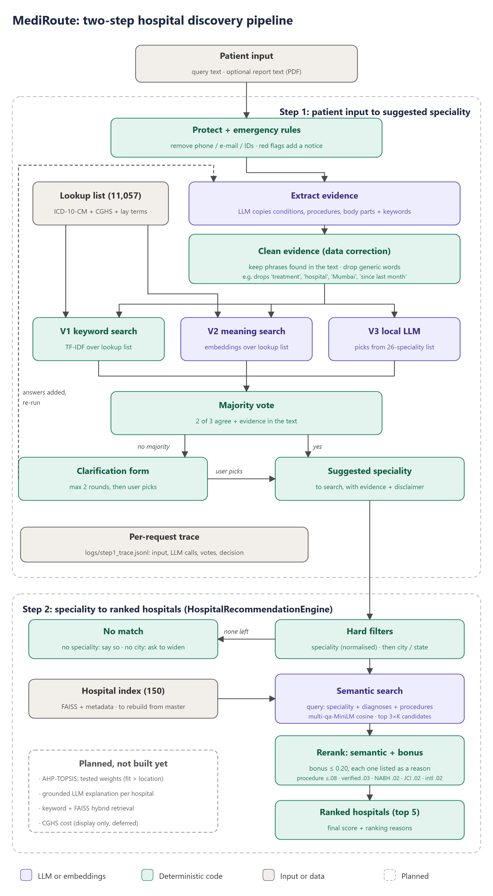
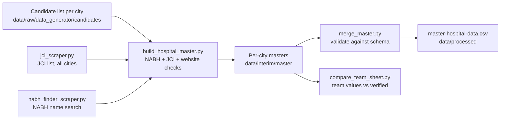

# MediRoute

**AI-assisted patient-to-hospital routing.** A patient describes their problem in plain language
(and can upload medical reports as PDFs). MediRoute works out the likely condition, the medical
specialty and the treatment needed, then recommends a **ranked, explained list of accredited
hospitals** with indicative costs.

> Capstone project, PG Program in AI/ML in Practice, IIT Bombay.

## Contents

1. [What problem does it solve?](#1-what-problem-does-it-solve)
2. [Architecture](#2-architecture)
   - [Step 1: Patient input to suggested speciality](#step-1-patient-input-to-suggested-speciality)
   - [Step 2: Specialty to ranked hospitals](#step-2-specialty-to-ranked-hospitals)
   - [Design choice: rules vs LLM](#design-choice-rules-vs-llm)
   - [Research basis](#research-basis)
   - [How the code maps to the architecture](#how-the-code-maps-to-the-architecture)
3. [Project structure](#3-project-structure)
4. [Setup](#4-setup)
5. [How to run](#5-how-to-run)
6. [How hospital data is extracted](#6-how-hospital-data-is-extracted)
   - [6.1 Sources](#61-sources)
   - [6.2 Pipeline](#62-pipeline)
   - [6.3 Where the data is kept](#63-where-the-data-is-kept)
   - [6.4 How to regenerate](#64-how-to-regenerate)
   - [6.5 Adding a city or hospital](#65-adding-a-city-or-hospital)
   - [6.6 Known limitations](#66-known-limitations)
7. [How to test](#7-how-to-test)
8. [Project tracker](#8-project-tracker)
9. [Disclaimer](#9-disclaimer)

---

## 1. What problem does it solve?

People who need specialist care, such as medical travellers and patients from smaller cities, often
don't know **which specialty** they need or **which hospital** is actually equipped for it. Today
this matching is done by human coordinators (Bookimed, Medmonks) or by opaque "AI matching" tools
that publish no evaluation.

MediRoute aims to be:

- **Accurate.** Three independent methods (keyword search, meaning search and a local LLM) must
  agree on the speciality, and every answer cites words from the patient's own text.
- **Transparent.** Hospitals are ranked by a deterministic, explainable method (AHP-TOPSIS), not
  by the LLM.
- **Grounded.** The LLM only *explains* results using the retrieved hospital records, so it can't
  invent hospitals.

## 2. Architecture



The pipeline has two steps. Each box is either an **LLM/embedding** component (purple),
**deterministic code** (green) or **input data** (grey). The diagram is generated by
[`docs/architecture/make_architecture_diagram.py`](docs/architecture/make_architecture_diagram.py);
the earlier version is kept as
[`mediroute_pipeline_architecture_v1.png`](docs/architecture/mediroute_pipeline_architecture_v1.png).

### Step 1: Patient input to suggested speciality

Step 1 does a hospital coordinator's routing job ("which department?"), not a doctor's job ("what
is wrong, what treatment?"). It outputs a **suggested speciality to search**, the words in the
patient's text that support it, and a disclaimer. API reference with examples and tracing:
[docs/api/step1_analyze_api.md](docs/api/step1_analyze_api.md).

| # | Stage | What it does | Type |
|---|-------|--------------|------|
| 1.1 | **Protect + emergency rules** | Remove phone numbers, e-mails and ID numbers. Fixed red-flag rules (chest pain with breathlessness, stroke signs, heavy bleeding, suicidal intent…) add an emergency notice; routing continues | Code |
| 1.2 | **Extract evidence** | The LLM copies conditions, procedures and body parts from the text; speciality keywords found in the text are added. Code keeps a phrase only if it really appears in the text (typos allowed) | LLM + code |
| 1.3 | **Three voters** | **V1** keyword search and **V2** meaning search over a lookup list of 10,584 entries (ICD-10-CM diagnoses + CGHS procedures, each mapped to a speciality by doctor-reviewable tables). **V3** a local LLM picks from the 26-speciality list; code rejects any other name | Code / embeddings / LLM |
| 1.4 | **Majority vote** | At least 2 of 3 voters name the same speciality **and** there is evidence in the text. General Medicine (the catch-all) asks one question before it is accepted | Code |
| 1.5 | **Clarify, else user picks** | No majority: a short form (body area, existing diagnosis, recommended procedure), up to 2 rounds, then the user picks from the list | Code |
| 1.6 | **Trace** | Every stage of every request is logged with a `request_id` in `logs/step1_trace.jsonl` (input, LLM calls, votes, decision) | Code |

Measured through the API on 12 scenarios (`scripts/api_smoke_step1.py`): all routed as intended,
including report text, emergency notice, both clarification paths and the user's choice; about
11–20 s per request on a CPU laptop.

**Step 1 → Step 2 in one call.** The frontend calls `POST /api/patient-routing`, a LangGraph
workflow (built by Shubham, integrated with Step 1): optional reports are parsed, Step 1 suggests the
speciality, and Step 2 ranks hospitals for it, or the flow returns a clarification (Step 1's form or
speciality list, a location question, or "no verified hospital yet"). Before/after and test results:
[docs/design/step1_step2_integration.md](docs/design/step1_step2_integration.md). Check all paths
with `python scripts/api_smoke_workflow.py`.

### Step 2: Specialty to ranked hospitals

| # | Stage | What it does | Type |
|---|-------|--------------|------|
| 2.1 | **Filter hospitals** | Keep only NABH hospitals offering the required specialty, near the preferred location | Code |
| 2.2 | **AHP weights + TOPSIS rank** | Score hospitals on expert-weighted criteria (staff, equipment, accreditation) | Code |
| 2.3 | **Write explanation** | Explain the ranking using **only** the retrieved records (grounded RAG) | LLM |
| 2.4 | **Result, translation, PDF** | Ranked list with CGHS cost (display only), sources, translation and a PDF export | Code |

### Design choice: rules vs LLM

| Step | Rules / code | LLM | Our choice |
|------|--------------|-----|------------|
| 1. Input to specialty | Fast and predictable, but misses new wording and can't read free text | Handles paraphrase and reports, but can hallucinate | **Vote.** Two search methods and an LLM vote; code requires a majority plus evidence from the text, otherwise it asks |
| 2. Specialty to hospitals | Transparent and repeatable, but needs expert weights | Flexible but opaque, and may invent hospitals | **Code ranks (AHP-TOPSIS).** The LLM only explains |

### Research basis

| Source | Finding | Used for |
|--------|---------|----------|
| Bookimed, Medmonks | Human coordinators match hospitals per request | Human-coordinator baseline |
| Şahin & Cezlan, 2022 | AHP weights from 7 experts, then TOPSIS. Staff, care quality and equipment rank highest | AHP criteria template (Step 2) |
| Rules vs AI triage, 2024 | Both above 70% accuracy, with equal safety | Baselines in both steps |
| Grounded RAG triage | Accuracy 0.802 vs 0.542 for a plain LLM | Grounding the LLM in retrieved records |
| Rule-system review | Heavy manual programming, weak on nuanced language | Why Step 1 uses an LLM |

*Figures come from the papers' abstracts. Verify them against the full sources before citing.*

### How the code maps to the architecture

Each step of the architecture is its own package. The two packages never import each other.
They share only `common/` (the `MedicalContext` hand-off object) and `utils/`.

| Architecture stage | Module(s) in `src/mediroute/` |
|--------------------|-------------------------------|
| **Step 1** | **`specialty_routing/`** (API routes in `specialty_routing/api.py`) |
| Patient input + reports | `/api/analyze`, `/api/reports/parse`, `extraction/pdf_parser.py` |
| 1.1 Protect + emergency rules | `step1/protect.py`, `step1/safety.py` |
| 1.2 Extract evidence | `step1/evidence.py`, `prompts/evidence_v1.txt` |
| 1.3 Voters | `step1/voters.py`, `step1/lookup.py` (lookup list + TF-IDF and embedding search), `prompts/specialty_v1.txt` |
| 1.4–1.5 Decide, clarify, user choice | `step1/pipeline.py` |
| 1.6 Trace | `step1/trace.py` |
| Service + baselines | `service.py` (`MEDIROUTE_ROUTING_MODE`: `vote` default; `rules`, `llm`, `hybrid` for evaluation), `routes.py` |
| **Hand-off** | **`common/medical_context.py`** (`MedicalContext`) |
| **Step 2** | **`hospital_recommendation/`** (API routes in `hospital_recommendation/api.py`) |
| 2.1 Filter + retrieve | `specialty_filter.py`, `retrieval/` (FAISS, filtered FAISS, TF-IDF keyword, semantic query builder) |
| 2.2 Rank | `ranking/hospital_reranker.py`, `engine.py` (AHP-TOPSIS is planned) |
| App + orchestration | `backend/main.py` (assembles the FastAPI app); `backend/workflow/` (LangGraph graph: `parse_reports` → `step1_route` → `recommend_hospitals` → finalize / clarification; endpoint `/api/patient-routing` in `workflow/api.py`) |
| Hospital data (NABH, JCI) | `data_generator/` (scrapers, master-dataset and FAISS index builders) |

See [docs/PROJECT_TRACKER.md](docs/PROJECT_TRACKER.md) for what is done and what is pending.

---

## 3. Project structure

```
MediRoute/
├── src/mediroute/                 # Python package (src layout)
│   ├── specialty_routing/         # STEP 1: patient input → specialty
│   │   ├── api.py                 # /api/analyze, /api/medical-context, /api/reports/parse, /api/icd10/*
│   │   ├── step1/                 # Voting pipeline: protect, safety, evidence, voters, pipeline, trace
│   │   ├── prompts/               # Versioned LLM prompts (evidence_v1, specialty_v1)
│   │   ├── service.py, routes.py  # Mode switch (vote / rules / llm / hybrid) and baseline routes
│   │   ├── router.py              # Earlier router (rules → embeddings → LLM → zero-shot), not used by the API
│   │   ├── icd10_mapper.py        # ICD-10 ↔ condition ↔ specialty
│   │   ├── schemas.py             # PatientRequest (incl. reportText, clarification, selectedSpecialty)
│   │   └── extraction/            # PDF parser, context extractor, aggregator, validator
│   ├── hospital_recommendation/   # STEP 2: specialty → ranked hospitals
│   │   ├── api.py                 # /api/hospitals/*
│   │   ├── engine.py              # Filter → retrieve → rerank
│   │   ├── specialty_filter.py, hospital_loader.py
│   │   ├── schemas.py             # HospitalRecommendationRequest
│   │   ├── retrieval/             # FAISS, filtered FAISS, keyword, semantic query builder
│   │   └── ranking/               # Reranker (AHP-TOPSIS planned)
│   ├── common/
│   │   └── medical_context.py     # MedicalContext: the Step 1 → Step 2 contract
│   ├── backend/                   # FastAPI app assembly
│   │   ├── main.py                # Creates the app, CORS, includes both step routers
│   │   └── workflow/              # LangGraph workflow (graph, nodes, decisions, state) + /api/patient-routing
│   ├── data_generator/            # Offline pipelines that build the files in data/
│   │   ├── jci_scraper.py, nabh_finder_scraper.py        # Accreditation scrapers (Playwright)
│   │   ├── build_hospital_master.py                      # Verify candidates (NABH, JCI, website) per city
│   │   ├── merge_master.py, compare_team_sheet.py        # Build/validate master CSV; check team sheets
│   │   ├── create_master_dataset.py, create_verification_sheet.py,
│   │   │   merge_verified_hospitals.py, check_verification_progress.py
│   │   ├── build_specialty_vocabulary.py, validate_specialty_normalization.py
│   │   └── build_hospital_embedding_dataset.py, build_faiss_index.py   # Vector store
│   └── utils/
│       ├── paths.py               # Single source of truth for all project paths
│       └── logging_config.py      # Shared "mediroute" logger (file + console)
├── frontend/                      # Static HTML/CSS/JS UI (patient, results, hospital pages)
├── tests/
│   ├── specialty_routing/         # Step 1 tests
│   ├── hospital_recommendation/   # Step 2 tests
│   └── workflow/                  # Step 1 + Step 2 graph tests
├── data/
│   ├── raw/                       # Source datasets and scraper inputs
│   ├── interim/                   # Scraper outputs (JCI, NABH, per-city masters)
│   ├── processed/                 # master-hospital-data.csv, hospital.schema.csv, verification sheets
│   ├── medical_taxonomy/          # specialties.csv, ICD/CGHS → speciality tables, step1_lookup.csv
│   └── vector_store/              # FAISS index and hospital metadata
├── scripts/                       # restart_app.ps1, smoke and verification scripts
├── docs/                          # Architecture diagram, project tracker, API playground, references
├── pyproject.toml                 # Package metadata and dependencies
├── setup.py                       # Shim for legacy tooling
├── requirements.txt               # Runtime dependencies
└── requirements-dev.txt           # Plus scraping, test and lint tools
```

## 4. Setup

Requirements: **Python 3.10+** (developed on 3.14), Windows/macOS/Linux, and
[Ollama](https://ollama.com) with `llama3.2` (`ollama pull llama3.2`) for Step 1's evidence and
LLM voter. Without Ollama, Step 1 still runs on keyword evidence and the two search voters.

The Step 1 lookup list (`data/medical_taxonomy/step1_lookup.csv`) is in the repo. To rebuild it,
download the CDC ICD-10-CM code descriptions (public domain) and run the builder:

```powershell
# ICD-10-CM 2026 order file -> data/raw/icd10cm_2026/extracted/ (not committed; ~23 MB)
Invoke-WebRequest "https://ftp.cdc.gov/pub/Health_Statistics/NCHS/Publications/ICD10CM/2026/icd10cm-Code%20Descriptions-2026.zip" -OutFile icd10cm.zip
Expand-Archive icd10cm.zip -DestinationPath data/raw/icd10cm_2026/extracted
python -m mediroute.specialty_routing.step1.lookup
```

The embedding cache for the lookup list (`data/vector_store/step1_lookup_embeddings_*.npy`) is
built on the first start (about 90 s) and reused afterwards.

```powershell
git clone https://github.com/shubhamgithhub/MediRoute.git
cd MediRoute

python -m venv .venv
.\.venv\Scripts\Activate.ps1          # macOS/Linux: source .venv/bin/activate

pip install -e ".[dev,scraping]"      # Editable install of the package plus dev tools
# or: pip install -r requirements-dev.txt; pip install -e . --no-deps

playwright install chromium           # Only needed for the scrapers
```

Optional environment variables:

| Variable | Default | Purpose |
|----------|---------|---------|
| `MEDIROUTE_DATA_DIR` | `./data` | Use a data folder in another location |
| `MEDIROUTE_LOG_DIR` | `./logs` | Where `mediroute.log` is written |
| `MEDIROUTE_HOST` / `MEDIROUTE_PORT` | `127.0.0.1` / `8000` | Used by the `mediroute-api` command |
| `OLLAMA_API_BASE_URL` | `http://127.0.0.1:11434` | Ollama server for Step 1 |
| `MEDIROUTE_ROUTING_MODE` | `vote` | Step 1 mode: `vote`, or the baselines `rules`, `llm`, `hybrid` |
| `MEDIROUTE_LLM_MODEL` | `llama3.2` | Ollama model used by Step 1 |
| `MEDIROUTE_LOG_PATIENT_TEXT` | `1` | `0` logs only a hash of the patient text. Set to `0` before any real patient data |

## 5. How to run

**Backend API**

```powershell
mediroute-api
# or
python -m uvicorn mediroute.backend.main:app --reload --host 127.0.0.1 --port 8000
# or, on Windows: also restarts Ollama and writes logs
.\scripts\restart_app.ps1
```

- Interactive API docs: http://127.0.0.1:8000/docs
- Health check: http://127.0.0.1:8000/api/health
- At start-up Step 1 loads its lookup index and warms up the LLM in the background. Wait for
  `Step 1 LLM warm-up done` in `logs/mediroute.log` before the first request (about 30 s, or
  about 2 minutes on the very first start while the embedding cache is built).
- Try Step 1: `python scripts/api_smoke_step1.py` (12 scenarios), or see
  [docs/api/step1_analyze_api.md](docs/api/step1_analyze_api.md).
- **Admin page** (request history): http://127.0.0.1:5500/admin.html. Every request with its
  input, evidence, the three votes and their lookup matches, each LLM call (timings, tokens, raw
  output, prompt), the decision, what was served and the Step 2 outcome. Data comes from
  `GET /api/admin/requests` and `GET /api/admin/requests/{id}`, which read
  `logs/step1_trace.jsonl`. **No login yet:** it shows patient text, so keep the API on 127.0.0.1.

**Frontend**

The frontend is static and calls the API at `http://127.0.0.1:8000`.

```powershell
python -m http.server 5500 --directory frontend
# open http://127.0.0.1:5500/index.html
```

**Main endpoints**

| Method | Path | Purpose |
|--------|------|---------|
| POST | `/api/patient-routing` | **End to end, used by the frontend:** optional PDFs + text + city (+ form answers) → Step 1 → Step 2 → ranked hospitals or a clarification (LangGraph workflow) — [integration notes](docs/design/step1_step2_integration.md) |
| POST | `/api/analyze` | Step 1 only: patient text (+ report text, form answers) to suggested speciality — [reference](docs/api/step1_analyze_api.md) |
| POST | `/api/reports/parse` | Upload PDF reports and extract text |
| POST | `/api/medical-context` | Build a structured medical context |
| POST | `/api/hospitals/recommend` | Medical context to ranked hospitals (Step 2) |
| POST | `/api/hospitals/semantic-recommendations` | FAISS semantic hospital search |
| GET | `/api/hospitals/search`, `/api/hospitals/keyword-search` | Location and keyword search |
| GET | `/api/icd10/map`, `/api/icd10/code/{code}` | ICD-10 lookups |

There are more request examples in [docs/API_TEST_PLAYGROUND.md](docs/API_TEST_PLAYGROUND.md).

**Data pipelines** (run from the repo root)

```powershell
# Hospital master data (NABH + JCI + official websites): see section 6 for the full steps
python -m mediroute.data_generator.build_hospital_master --candidates (Get-ChildItem data/raw/data_generator/candidates/*.csv) `
    --jci data/interim/jci/jci_all_cities.csv --out-dir data/interim/master
python -m mediroute.data_generator.merge_master

# Taxonomy and vector store (rebuild after the hospital dataset changes)
python -m mediroute.data_generator.build_specialty_vocabulary
python -m mediroute.data_generator.validate_specialty_normalization
python -m mediroute.data_generator.build_hospital_embedding_dataset
python -m mediroute.data_generator.build_faiss_index
```

## 6. How hospital data is extracted

The hospital master is built from **public, official sources only**. Each value is either checked
automatically or marked as a manual judgement. Every row carries the evidence behind it, such as a
certificate number, JCI ID, website status or source, so anyone can re-check it.

### 6.1 Sources

| Source | What we take from it | Link |
|--------|----------------------|------|
| NABH "Find a Healthcare Organisation" | NABH status, certificate number, certificate PDF, listed name and website | [nabh.co/find-a-healthcare-organisation](https://nabh.co/find-a-healthcare-organisation/) |
| JCI accredited organisations (India) | JCI status, IHCO ID, listed website | [jointcommission.org: JCI-accredited organisations](https://www.jointcommission.org/en/about-us/recognizing-excellence/find-accredited-international-organizations) |
| Each hospital's official website | Whether the site loads, the international-patients page, specialties | `official_source_url` column |
| Team workbook (one sheet per person) | Candidate hospitals, tiers, type, ownership | [Hosp_Data_Final.xlsx](data/raw/data_generator/Hosp_Data_Final.xlsx) |
| Specialty taxonomy | Normalises website wording to canonical specialties | [specialty_normalization.csv](data/medical_taxonomy/specialty_normalization.csv) |

Please read the [NABH terms and conditions](https://nabh.co/terms-and-conditions/) before
running the scrapers. The scrapers identify themselves with a contact email, wait between requests,
check `robots.txt`, and run one browser at a time.

### 6.2 Pipeline



1. **Candidate list.** One CSV per city in
   [data/raw/data_generator/candidates/](data/raw/data_generator/candidates/), one row per hospital.
   It holds the manual fields (`City_Tier`, `Hospital_Tier`, `hospital_type`, `ownership_type`) and
   lookup hints:
   - `nabh_query`: the word to search on NABH, e.g. `MIOT` (NABH lists "MIOT Hospitals").
   - `branch_hint`: a locality that must appear in the NABH address, e.g. `Porur`.
   - `jci_name`: the exact JCI organisation name after checking the JCI list, or `NONE` if the
     hospital is not on it. Chains have several entries per city, so this is set by hand.
   - `official_source_url`, `url_international` (optional), `review_note`, `source`.
2. **JCI list.**
   [jci_scraper.py](src/mediroute/data_generator/jci_scraper.py) reads every India result page and
   keeps organisations whose location contains one of the requested cities. It accepts a city in any
   part of the location, e.g. "Hosur Road, Anekal taluk, Bangalore".
3. **NABH lookup.**
   [build_hospital_master.py](src/mediroute/data_generator/build_hospital_master.py) types
   `nabh_query` into the NABH search box, using helpers from
   [nabh_finder_scraper.py](src/mediroute/data_generator/nabh_finder_scraper.py). A hospital counts
   as NABH-accredited only if all of these hold:
   - The certificate is a **hospital** certificate (`H-xxxx`). Blood bank (`BB-`), ethics
     committee (`EC-`), entry-level (`PEH-`) and lab certificates of the same group don't count.
   - The address is in the right city, and in the right branch when `branch_hint` is set.
   - The name shares a distinctive word with the hospital.

   Anything weaker is recorded as `Needs verification`, with the closest record named in `notes`.
4. **Website checks.** The script opens the official site: first the candidate's URL, then the
   website on the JCI record, then the one on the NABH record. It records the final URL after
   redirects, looks for an international-patients link, and extracts specialties from the page
   text and menus using the taxonomy.
5. **Scores.**
   - `verification_status`: `Verified` when there is an NABH hospital certificate and the website
     loads. `Partially verified` when only NABH or JCI is confirmed. Otherwise
     `Needs verification`.
   - `evidence_quality_score`: High, Medium or Low, from the number of checks passed.
6. **Merge and validate.**
   [merge_master.py](src/mediroute/data_generator/merge_master.py) combines the per-city files and
   checks every row against the schema: allowed values, required fields and unique `H###` IDs.
   It refuses to write the master if any check fails.
7. **Team-sheet check.**
   [compare_team_sheet.py](src/mediroute/data_generator/compare_team_sheet.py) compares a person's
   sheet in the workbook with the verified values field by field, so disagreements are visible.

### 6.3 Where the data is kept

| Path | Contents |
|------|----------|
| [data/raw/data_generator/Hosp_Data_Final.xlsx](data/raw/data_generator/Hosp_Data_Final.xlsx) | Team workbook: schema sheet, CGHS rates, one sheet per person |
| [data/raw/data_generator/candidates/](data/raw/data_generator/candidates/) | Candidate list per city (input to the pipeline) |
| [data/interim/jci/](data/interim/jci/) | JCI scraper output, e.g. `jci_all_cities.csv` |
| [data/interim/master/](data/interim/master/) | Per-city verified masters (`<city>_master.csv/.xlsx`), run logs, `<person>_comparison.csv` |
| [data/processed/hospital.schema.csv](data/processed/hospital.schema.csv) | **Final schema**: every column's type, allowed values and how it is populated |
| [data/processed/master-hospital-data.csv](data/processed/master-hospital-data.csv) | **Final master hospital data**, all cities (written by `merge_master.py`) |

### 6.4 How to regenerate

Run from the repo root after the [Setup](#4-setup) steps (`pip install -e ".[dev,scraping]"` and
`playwright install chromium`). If the package isn't installed, run `$env:PYTHONPATH="src"` first.

```powershell
# 1. JCI list. The JCI site blocks plain headless browsers, so start Chrome with a debugging
#    port and a throwaway profile, then let the scraper attach to it.
& "$env:ProgramFiles\Google\Chrome\Application\chrome.exe" --remote-debugging-port=9222 `
    --user-data-dir="$env:TEMP\chrome-cdp" --no-first-run about:blank
python -m mediroute.data_generator.jci_scraper --country India --cdp-url http://127.0.0.1:9222 `
    --output data/interim/jci/jci_all_cities.xlsx --cities "New Delhi" Delhi Gurugram Gurgaon `
    Chandigarh Mohali Panchkula Mumbai "Navi Mumbai" Nagpur Pune Chennai Kolkata Howrah Ahmedabad `
    Gandhinagar Kochi Bengaluru Bangalore Hyderabad Secunderabad Visakhapatnam Vizag

# 2. NABH + website checks for every city (about 30 s per hospital; existing city files are
#    skipped, so an interrupted run can be resumed; add --force to rebuild)
python -m mediroute.data_generator.build_hospital_master `
    --candidates (Get-ChildItem data/raw/data_generator/candidates/*.csv) `
    --jci data/interim/jci/jci_all_cities.csv --out-dir data/interim/master

# 3. Merge, validate and write data/processed/master-hospital-data.csv
python -m mediroute.data_generator.merge_master

# 4. (optional) Compare a team member's sheet with the verified values
python -m mediroute.data_generator.compare_team_sheet --sheet RaviTeja
```

To rebuild just one city, pass its candidate file with `--force`, e.g.
`--candidates data/raw/data_generator/candidates/chennai.csv --force`. Then re-run `merge_master`.

### 6.5 Adding a city or hospital

1. Add a row to the city's candidate CSV, or create `<city>.csv` with the same header, using the
   next free `H###` ID.
2. Search the hospital on [NABH](https://nabh.co/find-a-healthcare-organisation/) and set
   `nabh_query` to the word that finds it, and `branch_hint` to a locality from its address.
   Chain branches are often listed under a legal name or a different locality, for example:
   - "Krishna Institute of Medical Sciences" for KIMS Secunderabad
   - "Apollo Speciality Hospital" for Apollo Jayanagar
   - "Sector-6" for Medicover MVP Colony

   A broad query such as "Apollo Hospitals" returns too many branches to page through, so search
   for the branch locality instead.
3. Look it up in `data/interim/jci/jci_all_cities.csv`. Copy the exact `Organization` name into
   `jci_name`, or write `NONE`. If the city is new, add it to the JCI command in step 1, to
   `JCI_CITY_GROUPS` in `build_hospital_master.py`, and to `CITY_ALIASES` in
   `nabh_finder_scraper.py`.
4. Re-run that city with `--force`, check the `notes` column, then run `merge_master`.

### 6.6 Known limitations

- `City_Tier`, `Hospital_Tier`, `hospital_type` and `ownership_type` are manual judgements from
  the candidate list. Each row's `notes` column says so.
- `cost_band_inr` is `NA` until a band definition is agreed. The intended source is the CGHS sheet
  in the workbook. The draft design for treatment cost data (one hospital to many treatment costs)
  is in [docs/design/treatment_cost_data_design.md](docs/design/treatment_cost_data_design.md).
- Specialties are ranked by how often they appear on the website, so they show what the site
  highlights, not clinical capacity. The full list is in `specialties_all_found`.
- Some hospitals' websites are down or block automated browsers. Those rows show the error in
  `website_status` and are not marked `Verified`.

## 7. How to test

```powershell
pytest                                   # Whole suite
pytest tests/specialty_routing           # Step 1 only
pytest tests/hospital_recommendation     # Step 2 only
python tests/hospital_recommendation/test_retrieval_pipeline.py   # Each file also runs as a script with a printed report
```

- `tests/specialty_routing/` covers ICD-10 mapping, medical context extraction, context
  validation and specialty inference.
- `tests/hospital_recommendation/` covers the semantic query builder, keyword and FAISS
  retrieval, and the end-to-end recommendation pipeline.
- Test cases are kept as data in `data/medical_taxonomy/*_test_cases.csv`.
- To run end-to-end API smoke checks, start a server and then run
  `python scripts/smoke_test_api.py`, or run `python scripts/verify_specialty_route.py`, which
  starts and stops its own server.

## 8. Project tracker

The milestones, status of each architecture stage, and next steps are in
**[docs/PROJECT_TRACKER.md](docs/PROJECT_TRACKER.md)**.

## 9. Disclaimer

MediRoute is an academic decision-support prototype. It is **not** a medical device and does not
give medical advice. Recommendations must be reviewed by a qualified clinician.
