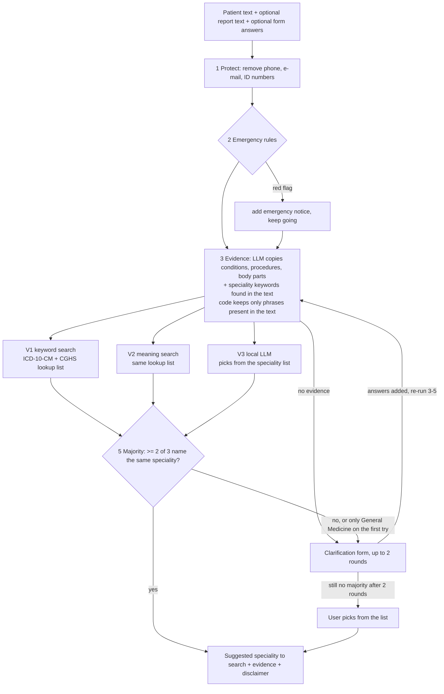

# Step 1 API: `POST /api/analyze`

Turns what the patient types (and, optionally, report text and answers to a short form) into a
**suggested speciality to search**. It is hospital discovery support, not a diagnosis.

Design: [step1_specialty_routing_design.md](../design/step1_specialty_routing_design.md) ·
Code: [`src/mediroute/specialty_routing/step1/`](../../src/mediroute/specialty_routing/step1/) ·
Tests: [`tests/specialty_routing/test_step1_pipeline.py`](../../tests/specialty_routing/test_step1_pipeline.py)

## Contents

1. [How it works](#1-how-it-works)
2. [Request](#2-request)
3. [Response](#3-response)
4. [The clarification flow](#4-the-clarification-flow)
5. [Examples you can run](#5-examples-you-can-run)
6. [Tracing a request in the logs](#6-tracing-a-request-in-the-logs)
7. [Configuration](#7-configuration)
8. [Known limitations](#8-known-limitations)

---

## 1. How it works



| Stage | Done by | What it does |
|-------|---------|--------------|
| 1 Protect | Code | Removes e-mails, 10–15-digit phone numbers and long ID numbers. Clinical numbers ("eGFR 8", "14x9 cm", dates) are kept |
| 2 Emergency check | Code (rules) | Red flags: chest pain with breathlessness or sweating, stroke signs, unconscious, heavy bleeding, suicidal intent, a seizure that won't stop. Adds a notice; routing continues |
| 3 Evidence | LLM + code | The LLM (`prompts/evidence_v1.txt`) copies phrases; code keeps a phrase only if ≥ 60% of its words are in the text (typos and common abbreviations allowed). Speciality keywords found word for word are always added |
| 4 V1 keyword | Code (TF-IDF) | Searches each evidence phrase in the lookup list: 9,314 ICD-10-CM categories + 1,270 CGHS procedures, each mapped to a speciality by draft, doctor-reviewable tables |
| 4 V2 meaning | Embeddings (all-MiniLM-L6-v2) | Same lookup list, by meaning |
| 4 V3 LLM | Local LLM (Ollama `llama3.2`) | Picks from the 26 canonical specialities (JSON-schema enum, temperature 0, `prompts/specialty_v1.txt`); code rejects any other name. Doesn't use the lookup list, so it stays independent |
| 5 Decide | Code | At least 2 of 3 voters name the same speciality **and** there is evidence. General Medicine (the catch-all) only wins a search voter when no specialist matched, and a General Medicine majority asks one question first |

Lookup tables (all `review_status=draft`, for the doctor to review):
[`icd10_block_specialty.csv`](../../data/medical_taxonomy/icd10_block_specialty.csv),
[`cghs_label_specialty.csv`](../../data/medical_taxonomy/cghs_label_specialty.csv),
[`cghs_name_overrides.csv`](../../data/medical_taxonomy/cghs_name_overrides.csv). The list itself is
[`step1_lookup.csv`](../../data/medical_taxonomy/step1_lookup.csv); rebuild it with
`python -m mediroute.specialty_routing.step1.lookup`.

## 2. Request

`POST http://127.0.0.1:8000/api/analyze` with a JSON body. Only `requirement` is needed for a
first request.

| Field | Type | Default | Meaning |
|-------|------|---------|---------|
| `requirement` | string | `""` | What the patient types |
| `location` | string | `"No preference"` | Preferred city (used by Step 2) |
| `language` | string | `"English"` | Display only for now |
| `additionalPreference` | string | `""` | Used as the text only if `requirement` is empty |
| `reportName` | list / string | `[]` | File names, display only |
| `reportText` | string | `""` | Text of uploaded reports. Get it from `POST /api/reports/parse` (`documents[].text`) |
| `clarification` | object | `null` | Form answers: `body_area`, `existing_diagnosis`, `recommended_procedure` (all optional) |
| `clarificationRound` | int | `0` | How many forms the user has already answered |
| `selectedSpecialty` | string | `null` | The speciality the user picked from the list |
| `parentRequestId` | string | `null` | `request_id` of the first request of this search; links the rounds in the logs |
| `debug` | bool | `false` | Adds `debug.votes` and the list of trace stages to the response |

## 3. Response

The Step 1 result is in `medicalContext`. Real response (16.8 s on a CPU laptop):

```json
{
  "request_id": "7d6c15fca884",
  "parent_request_id": null,
  "decision": "majority",
  "suggested_specialty": "Orthopaedics",
  "suggested_specialty_label": "Suggested speciality to search: Orthopaedics",
  "care_category": "Musculoskeletal Care",
  "in_hospital_data": true,
  "evidence": ["osteoarthritis of both knees", "knee replacement"],
  "reason": "3 of 3 independent methods agree.",
  "emergency": false,
  "emergency_message": null,
  "clarification_required": false,
  "clarification": null,
  "user_choice": null,
  "disclaimer": "Hospital discovery support only. This is a suggested speciality to search, not a diagnosis or medical advice. A doctor at the hospital confirms any treatment plan.",
  "latency_ms": 16758,
  "relevantSpecialty": "Orthopaedics",
  "careCategory": "Musculoskeletal Care"
}
```

| Field | Meaning |
|-------|---------|
| `request_id` | Look this up in `logs/step1_trace.jsonl` |
| `decision` | `majority` · `clarification_required` · `needs_user_choice` · `user_selected` |
| `suggested_specialty` | One of the 26 canonical names, or `null` when a question or choice is needed |
| `in_hospital_data` | `false` for specialities no hospital in our master lists yet (Ophthalmology, ENT, Dermatology, Psychiatry, General Medicine) |
| `evidence` | Phrases from the patient's own text that support the answer |
| `emergency`, `emergency_message` | Show the message first when `emergency` is true |
| `clarification` | The form to show: `round`, `max_rounds`, `fields[]` (`name`, `label`, `type`, `options`/`placeholder`) |
| `user_choice` | `suggested_first` (what the voters leaned to) and `options` (all specialities) |
| `relevantSpecialty`, `careCategory` | Same as above, kept for the current results page |

Votes, scores and lookup hits stay in the logs; send `"debug": true` to also get them in the
response.

## 4. The clarification flow

```
request 1  {requirement}                                  -> clarification_required (round 1 of 2)
request 2  {requirement, clarification, clarificationRound: 1, parentRequestId}
                                                          -> majority  (or round 2 form)
request 3  {..., clarificationRound: 2}                   -> majority  or needs_user_choice
request 4  {..., selectedSpecialty: "Orthopaedics"}       -> user_selected
```

The frontend ([patient.js](../../frontend/js/patient.js)) keeps the first `request_id` and sends it
as `parentRequestId` in every later round.

## 5. Examples you can run

Start the API (see [README §5](../../README.md#5-how-to-run)), wait for
`Step 1 LLM warm-up done` in the log, then:

**PowerShell**

```powershell
$body = @{ requirement = "Doctor advised CABG for my father."; location = "Chennai"; language = "English" } | ConvertTo-Json
(Invoke-RestMethod -Uri http://127.0.0.1:8000/api/analyze -Method Post -ContentType "application/json" -Body $body).medicalContext
```

**curl**

```bash
curl -s -X POST http://127.0.0.1:8000/api/analyze -H "Content-Type: application/json" \
  -d '{"requirement": "Doctor advised CABG for my father.", "location": "Chennai", "language": "English"}'
```

**With report text and a clarification answer**

```json
{
  "requirement": "weakness",
  "reportText": "MRI LUMBAR SPINE: L4-L5 disc prolapse compressing the left L5 root.",
  "clarification": {"body_area": "Bones, joints and muscles", "existing_diagnosis": "slipped disc L4-L5"},
  "clarificationRound": 1,
  "parentRequestId": "b6ade44c611c"
}
```

**All scenarios at once:** `python scripts/api_smoke_step1.py` sends 12 requests (clear diagnosis,
procedure only, report, emergency, phone redaction, both clarification paths and the user's
choice). Result on 2026-11-10:

| Scenario | Decision | Speciality | Votes V1 / V2 / V3 |
|----------|----------|-----------|--------------------|
| Osteoarthritis of both knees, knee replacement | majority | Orthopaedics | Ortho / Ortho / Ortho |
| "Doctor advised CABG" | majority | Cardiothoracic Surgery | CTS / CTS / CTS |
| Angiography report: triple vessel disease, CABG | majority | Cardiothoracic Surgery | CTS / CTS / Cardiology |
| Crushing chest pain, sweating, can't breathe | majority + **emergency notice** | Cardiology | Cardio / Emergency Med / Cardio |
| Cataract + phone number | majority (phone redacted in logs) | Ophthalmology | Ophth ×3 |
| "weakness" | clarification (General Medicine majority) | — | GM ×3 |
| … + "slipped disc L4-L5", bones and joints | majority | Orthopaedics | Ortho / Neurosurgery / Ortho |
| "I need surgery in India" → no detail twice | needs_user_choice → user_selected | Orthopaedics (picked) | Urology / ENT / CTS |

## 6. Tracing a request in the logs

Every stage writes one JSON line to **`logs/step1_trace.jsonl`** with the same `request_id`, and a
one-line summary to `logs/mediroute.log`.

| Stage | Logged |
|-------|--------|
| `input` | Redacted text (or hash + length), report length, form answers, round, chosen speciality, redaction counts |
| `emergency_check` | Rules matched, message |
| `llm_call` (evidence) | Model, prompt version, full prompt, options (temperature, seed), duration, Ollama timings, token counts, raw response, parsed JSON, errors |
| `evidence` | Phrases kept per kind (`conditions`, `procedures`, `body_parts`, `keyword_matches`), phrases dropped and why |
| `vote` ×3 | Voter, method, top 3 with scores, time, lookup hits (entry, text, speciality, score); V3 also its evidence terms and rejected names |
| `llm_call` (vote) | Same detail as above for V3 |
| `votes_summary` | Each voter's top-1, tally, best match |
| `decision` | Method (`majority`, `clarification_required`, `needs_user_choice`, `user_selected`), selected speciality, agreeing voters, reason |
| `response` | What was returned, total time |

```powershell
# every event of one request, in order
Get-Content logs\step1_trace.jsonl | ConvertFrom-Json | Where-Object request_id -eq "7d6c15fca884" |
  Select-Object t_ms, stage, voter, stage_for, method, top3, selected_specialty
# all rounds of one search
Get-Content logs\step1_trace.jsonl | ConvertFrom-Json | Where-Object { $_.parent_request_id -eq "b6ade44c611c" }
```

Timeline of the example above: `input` 0 ms → `emergency_check` 1 ms → evidence LLM call 7.9 s →
V1 0.1 s → V2 0.3 s → V3 LLM call 8.5 s → `decision` 16.8 s.

## 7. Configuration

| Variable | Default | Effect |
|----------|---------|--------|
| `MEDIROUTE_ROUTING_MODE` | `vote` | `vote` (this pipeline), or the baselines `rules`, `llm`, `hybrid` |
| `MEDIROUTE_LLM_MODEL` | `llama3.2` | Ollama model for evidence and V3 |
| `OLLAMA_API_BASE_URL` | `http://127.0.0.1:11434` | Ollama server |
| `MEDIROUTE_LLM_TIMEOUT_S` | `90` | Per LLM call |
| `MEDIROUTE_LOG_PATIENT_TEXT` | `1` | `0` logs only a hash and length of the patient text. **Set to `0` before any real patient data (DPDP)** |

If Ollama is down, evidence falls back to keyword matches and V3 abstains; V1 and V2 can still
form a majority.

## 8. Known limitations

- About **11–20 s per request** on a CPU laptop (two LLM calls); the first request after a restart
  can take up to a minute while the machine settles.
- The mapping tables are drafts; doctor review is pending.
- English only; no OCR for scanned PDFs.
- Two voters (V1, V2) share the lookup list, so a wrong table row can affect both.
