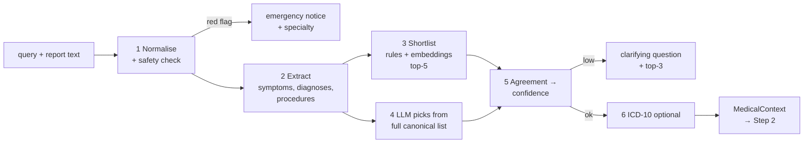

# Step 1: patient input → specialty (design)

**Status:** Agreed (decisions in §7 accepted 2026-11-06) · **Owner:** Pravin (with Claude Code) · **Date:** 2026-11-06
**Covers tracker tasks:** 3, 4, 5, 7, 8, 9 (Step 1) and the Step 1 side of 14, 19, 21, 22

## Contents

1. [What Step 1 must do](#1-what-step-1-must-do)
2. [Fit check of the current API](#2-fit-check-of-the-current-api)
3. [Design](#3-design)
4. [Open-source model choice](#4-open-source-model-choice)
5. [API contract](#5-api-contract)
6. [Evaluation and baselines](#6-evaluation-and-baselines)
7. [Decisions (agreed)](#7-decisions-agreed)
8. [Assumptions](#8-assumptions)
9. [Implementation plan](#9-implementation-plan)

---

## 1. What Step 1 must do

From [docs/base](../base/README.md) (mid-sem report and TA feedback):

| # | Requirement | Source |
|---|-------------|--------|
| R1 | Turn a free-text query (and, if given, report text) into **one primary specialty** plus ranked alternatives | Report, TA "diagnosis-to-specialty mapping" |
| R2 | Use **only specialties Step 2 can match** in the hospital data | TA "verified hospital-specialty dataset", tracker task 9 |
| R3 | **Explainable:** show the terms and reason behind the choice | TA "reliability, explainability" |
| R4 | **Say when unsure:** ask a clarifying question instead of guessing | Tracker task 8, TA "ambiguous cases" |
| R5 | Stay **discovery, not diagnosis**. Flag emergencies and never give medical advice | TA safety point |
| R6 | **Measurable against baselines:** keyword and rule baselines, top-1 and top-3 accuracy on a gold set | TA "baselines", tracker tasks 21–22 |
| R7 | Output feeds Step 2 as `MedicalContext` | Tracker task 14 |
| R8 | Report latency and cost per query; run on our hardware | Course guidelines (deployment layer) |
| R9 | Synthetic or de-identified data only; handle patient text carefully | TA privacy / DPDP |

## 2. Fit check of the current API

Tested on 2026-11-06: `pytest tests/specialty_routing` (3 pass, 1 fail) plus a direct probe of
the local Ollama model. Machine: i5-1135G7, 8 GB RAM, no NVIDIA GPU, so the model runs on CPU.

**What works:** `/api/analyze` accepts the request. The router chains rules → embeddings →
Ollama LLM → zero-shot, with a fallback at each step. Ollama is installed and running with
`llama3.2` (3B). PDF parsing and the `/api/medical-context` endpoint exist.
`restart_app.ps1` starts Ollama and the backend.

**Gaps against the requirements:**

| # | Gap | Evidence | Breaks |
|---|-----|----------|--------|
| G1 | **The candidate list is wrong.** The LLM and the embeddings choose from `specialty_vocabulary.csv`, 88 raw hospital names such as "Ayurveda & Modern Medicine" and "Liver Care". It has no Ophthalmology at all. The keyword rules use a different set of 16 names | Failing test: "My vision is blurry" → **"Liver Care"** | R1, R2 |
| G2 | **Output names don't match the hospital data.** Rules say "Obstetrics & Gynecology"; the master says "Obstetrics & Gynaecology". Four rule specialties (Ophthalmology, ENT, Dermatology, Psychiatry) don't appear in any hospital's `verified_specialties` | Master has 21 specialty names | R2, R7 |
| G3 | **The LLM's answer isn't validated.** Any string it returns is passed through | `_parse_ollama_response` | R2 |
| G4 | **Confidence is the LLM's own number.** In the probe it said 0.9–1.0 every time, including on its one wrong answer | Probe, 8 queries | R4 |
| G5 | **A new router is built for every request.** It detects Ollama again and reloads MiniLM and BART-large-MNLI (1.6 GB) each time | `infer_medical_context_from_query` | R8 |
| G6 | **The timeout is shorter than the model's load time.** The first call takes 23 s to load the model, but the timeout is 20 s. So the request falls through to zero-shot, which then overrides a correct rule result (task 4) | Test log, probe | R1 |
| G7 | **Reports are ignored.** `/api/analyze` reads `requirement`, or `additionalPreference` only if `requirement` is empty. `reportName` holds file names only | `api.py` | R1 |
| G8 | **No clarification, emergency flag or `MedicalContext` in the response.** It returns one specialty only, with no alternatives | `api.py` | R4, R5, R7 |
| G9 | **Full patient text is written to the log** at INFO level | `router.py`, `api.py` | R9 |
| G10 | **No mode switch.** Rules, embeddings and the LLM can't be run on their own, so they can't be evaluated separately | Task 3 | R6 |

**Verdict:** the API is a good skeleton (endpoint, fallback chain, local LLM), but it does not yet
meet R1–R7. Most of the failures come from G1/G2, the specialty list, not from the model.

**Probe result.** I gave `llama3.2` a clean list of 21 specialty names, temperature 0 and JSON
output. It got **7 of 8** queries right in about **4 s each**, after a 23 s cold load. The miss
was "kidneys failed, on dialysis, looking for transplant" → Nephrology instead of Organ
Transplant, which is arguably a defensible answer. So a small local model is good enough **if the
candidate list and validation are fixed**.

## 3. Design



**0. One canonical specialty list (task 9).** A new file, `data/medical_taxonomy/specialties.csv`,
loaded by `common/specialties.py`. Both steps use only this list.
- Columns: `specialty, description, keywords, aliases, in_hospital_data`.
- The `description` and `keywords` columns feed the embeddings and the LLM prompt, so the LLM
  sees what each name means.
- It starts from the 21 names in the hospital master. Coverage of the specialties the master
  lacks (Ophthalmology etc.) is decision 1.

**1. Normalise and safety check.** Clean the text. Run a small rule list of red flags (stroke
signs, chest pain with breathlessness, heavy bleeding, suicidal intent). A match adds
`emergency: true` and a fixed notice to seek local emergency care, then routing continues. Rules
only, no LLM, so the check is predictable.

**2. Extract.** The LLM fills the existing `MedicalContext` fields (`symptoms`, `diagnoses`,
`procedures`) from the query plus any report text, using a JSON schema. The current rule-based
extractor stays as the fallback and as an extraction baseline. Extraction quality is evaluated
separately, as the TA asked.

**3. Shortlist (independent evidence).** Take the union of:
- keyword/alias rule hits, and
- embedding top-5 (MiniLM, already used), where the query plus extracted terms are compared with
  each specialty's `description + keywords`.

The result is 3–6 specialties with scores and matched terms. The shortlist is **not** a filter on
the LLM. It is a second opinion, used for confidence in step 5 and as the answer when the LLM is
down.

**4. LLM picks (constrained to the full list).** Ollama's `format` takes a JSON schema whose
`specialty` field is an **enum of the whole canonical list (about 26 names) plus `Unclear`**, so
the model cannot invent a name. It returns `specialty`, `alternatives` (up to 2),
`evidence_terms` and `reason` (one sentence). The prompt is a versioned file
(`prompts/specialty_v1.txt`) and is logged with each evaluation run.

Why the full list and not the shortlist: tested on 2026-11-06, Ollama does enforce the enum. But
if the right answer is missing, the model is forced into a wrong one. "My vision is blurry", with
only Cardiology / Pulmonology / Gastroenterology allowed, came back as Cardiology, while the
model's own reason said that was unlikely. About 26 names fit easily in the prompt.

**5. Validate and decide.** Confidence comes from **agreement**, not from the LLM's own number:

| Signal | Confidence |
|--------|-----------|
| LLM pick = rule top **and** in embedding top-3 | High |
| LLM pick in embedding top-3, or = rule top | Medium |
| Neither, LLM said `Unclear`, LLM failed, or no terms extracted | Low → `clarification_required`, return top-3 plus one clarifying question |

If the LLM is down or times out, use the rule/embedding result and mark it `mode_used: "fallback"`.

**6. ICD-10 (task 7, optional for the demo).** Map extracted diagnoses with the existing
`ICD10Mapper`. The ICD-10 code is extra context only; it does not change the specialty.

**Runtime.**
- The router is created **once at startup** (FastAPI lifespan), not per request.
- A warm-up call at startup and `keep_alive` keep the model loaded.
- LLM timeout 60 s.
- BART zero-shot is removed from the live path and kept only as an evaluation baseline.
- Logs record a hash and length of the query, not the text (G9). Debug mode can log text locally.

**Modes (task 3).** `mode = rules | embeddings | llm | hybrid` (default `hybrid`), set by config
or a query parameter. The same pipeline, with stages switched off, gives the baselines in §6.

## 4. Open-source model choice

The constraints are CPU only and 8 GB RAM shared with the API and MiniLM. So **3–4B models at
4-bit**; 7–8B models need about 5 GB and take more than 15 s per query on this laptop.

| Model (Ollama tag) | Size | Role | Why |
|--------------------|------|------|-----|
| `llama3.2:3b` | 2.0 GB | **Default** | Already installed, 7/8 in the probe, about 4 s warm, Llama 3.2 Community licence |
| `qwen2.5:3b` | 1.9 GB | Comparison run | Strong at structured JSON output, good multilingual. The 3B size uses the Qwen Research licence (non-commercial), which is fine for a capstone; the 7B is Apache-2.0 |
| `phi3.5` / `gemma2:2b` | 2.2 / 1.6 GB | Optional extra comparison | Only if time allows |
| `qwen2.5:7b` (or a hosted model) | 4.7 GB | **LLM-as-judge only**, offline | The guidelines want the judge to be a **different model** from the one under test. It runs offline on the gold set, so speed doesn't matter |

The model is chosen by **evaluation results on the gold set** (§6), not by preference, and the
experiment is logged. Medical fine-tuned models (e.g. Meditron) are left out: they are 7B+, and
selecting from a short list doesn't need them.

For deployment (task: Aniket), the same code runs against any Ollama host by
`OLLAMA_API_BASE_URL`. A small cloud VM with Ollama or a GPU instance works without code changes.

## 5. API contract

`POST /api/analyze`. The request is unchanged, plus an optional `reportText` field, which
`/api/medical-context` can fill. Response `medicalContext`:

```json
{
  "primary_specialty": "Ophthalmology",
  "alternatives": [{"specialty": "Neurology", "score": 0.41}],
  "confidence": "high",
  "evidence_terms": ["blurry vision"],
  "reason": "Blurred vision is an eye symptom.",
  "symptoms": ["blurry vision"], "diagnoses": [], "procedures": [],
  "icd10_codes": [],
  "clarification_required": false,
  "clarification_question": null,
  "emergency": false,
  "mode_used": "hybrid",
  "model": "llama3.2:3b",
  "prompt_version": "specialty_v1",
  "latency_ms": 4100,
  "disclaimer": "Hospital discovery support only, not a diagnosis."
}
```

These fields extend the shared `common/medical_context.py` model, so Step 2 reads them directly
(task 14). `relevantSpecialty` and `careCategory` are kept for one release so the current frontend
doesn't break.

## 6. Evaluation and baselines

- **Gold set** (task 19, Anand/Ravi): 50+ queries, each labelled with the expected specialty and
  acceptable alternatives. Mix of clear, vague, misspelled, multi-symptom, report-based and
  emergency cases. Doctor review if possible.
- **Systems compared:**
  - keyword rules (baseline)
  - embeddings only (baseline)
  - BART zero-shot (baseline)
  - LLM only
  - hybrid with `llama3.2`
  - hybrid with `qwen2.5:3b`
- **Metrics:**
  - top-1 accuracy, top-3 accuracy, macro-F1 by specialty
  - clarification rate, and accuracy on the queries that were *not* sent to clarification
  - emergency recall
  - p50/p95 latency
- **Script:** `scripts/eval_step1.py --mode … --model …` writes a CSV and a row in
  `docs/experiments_log.md`. Change one thing per run.

## 7. Decisions (agreed)

Accepted by Pravin on 2026-11-06.

| # | Decision | Agreed |
|---|----------|-------------|
| 1 | Specialties a patient may need but no hospital lists (Ophthalmology, ENT, Dermatology, Psychiatry) | Keep them in the list with `in_hospital_data = false`. Step 1 still routes correctly, and Step 2 says "no verified hospital for this specialty yet". Ask Anand/Ravi whether hospital pages list them |
| 2 | Granularity: Cardiology vs Cardiothoracic Surgery, Neurology vs Neurosurgery, Nephrology vs Organ Transplant | Keep them separate (they are separate in the hospital data). The gold set accepts the related one as an alternative |
| 3 | Default model | `llama3.2:3b` now; switch only if `qwen2.5:3b` wins on the gold set |
| 4 | LLM extraction in step 2, or rules only | LLM with rule fallback (one extra call is about 4 s). Measure whether it helps; drop it if not |
| 5 | Remove BART zero-shot from the live path | Yes, evaluation baseline only |
| 6 | Multilingual input (`language` field) | Out of scope for now (TA: translation is secondary); English only, noted as a limitation |

## 8. Assumptions

Each row gives the assumption, why we make it, how it gets checked, and what we do if it is
false. "Checked" means measured on 2026-11-06 on Pravin's laptop.

| # | Assumption | Why / evidence | How it is checked | If false |
|---|------------|----------------|-------------------|----------|
| A1 | **The demo and first deployment run on a CPU machine like Pravin's laptop** (i5, 8 GB RAM, no GPU) | The only machine measured so far; the ₹40k budget favours no GPU | Deployment owner confirms the target host | A GPU or larger VM lets us try 7–8B models with no code change (`OLLAMA_API_BASE_URL`) |
| A2 | **About 10 s per query (p95) is acceptable** for the demo | The patient waits once per search; Step 2 adds little | p95 latency in the evaluation report | Skip LLM extraction (step 2), shorten the prompt, or use rules + embeddings only |
| A3 | **A 3B model is accurate enough when it chooses from a short, well-described list** | Checked: 7/8 on a clean 21-name list | Top-1 / top-3 accuracy on the gold set vs baselines | Try `qwen2.5:3b`, then a 7B model on a bigger host |
| A4 | **The LLM's own confidence number is not reliable** | Checked: 0.9–1.0 on every query, including the wrong one | — | Already not used; agreement decides confidence |
| A5 | **Ollama enforces the JSON-schema enum** | Checked with Ollama 0.40.14: only allowed names came back | Unit test with a mocked call and a live call | Validate in code anyway (G3), and fall back to the shortlist |
| A6 | **One primary specialty per query is enough**, with up to 2 alternatives | Matches how Step 2 filters hospitals | The gold set includes multi-condition queries; we also count "correct in top 3" | Step 2 searches the alternatives too |
| A7 | **The 21 names in the hospital master's `verified_specialties` are the vocabulary Step 2 can match** | The master was verified from official sites (task 18) | A `specialties.csv` load test checks every master name is in the list | Update `specialties.csv`, not the router code |
| A8 | **Patients need a few specialties that no hospital lists yet** (Ophthalmology, ENT, Dermatology, Psychiatry, General Medicine) | Common medical-travel needs; the rules already had them | The gold set covers them | Step 2 shows "no verified hospital yet"; the data team may add them |
| A9 | **Input is English text** of 1–5 sentences; report text arrives already extracted (no OCR) | The TA ranks translation as secondary; the PDF parser has no OCR | The gold set is English | Noted as a limitation with a fix path (translate first) |
| A10 | **The agreement thresholds (High / Medium / Low) are starting values** | No data yet to tune them | Tune on the gold set: few wrong answers among High, clarification rate under about 20% | Change the rule; it is config, not code |
| A11 | **Red-flag rules are a safety net, not triage**: a short keyword list (stroke signs, chest pain with breathlessness, heavy bleeding, suicidal intent) | Predictable and explainable; the TA asked to keep discovery separate from clinical decisions | Emergency recall on the gold set's emergency cases | Add keywords; never let the LLM decide emergencies alone |
| A12 | **LLM extraction of symptoms and diagnoses improves routing enough to justify about 4 s more** | Not known yet | Run with and without step 2 on the gold set | Turn it off (`extract = rules`) |
| A13 | **The gold set is synthetic and labelled by the team**, ideally reviewed by a doctor | The TA asked for independent review; real patient data is not allowed | Review status recorded on each row | Report the limitation; keep the labels versioned |
| A14 | **The model licences allow academic, non-commercial use** (Llama 3.2 Community, Qwen Research for the 3B) | The capstone is non-commercial | Licence noted in the README | Use the Apache-2.0 `qwen2.5:7b` or another permissive model |
| A15 | **No real patient data is stored.** Logs keep a hash and the length of the query, not the text | DPDP and the TA's privacy point | A log check in the tests | — |
| A16 | **Step 2 will read the new `MedicalContext` fields.** The old `relevantSpecialty` / `careCategory` stay for one release for the frontend | The task 14 owner (Shubham) agrees the contract in Task 0 | A contract test across both steps | Keep the old fields longer |

## 9. Implementation plan

Each step is one commit with tests.

| Step | Task | Output |
|------|------|--------|
| 1 | 9 | `specialties.csv` + `common/specialties.py`; router and Step 2 normaliser read it |
| 2 | 3 | Router built once at startup, warm-up, timeout, `mode` switch, privacy-safe logging |
| 3 | 5 | Candidate generation (rules + embeddings) and constrained LLM choice with JSON-schema enum |
| 4 | 4, 8 | Agreement-based confidence, clarification question, emergency rules; failing test fixed |
| 5 | 14 | Response contract (§5) in `MedicalContext`; old fields kept |
| 6 | 22 | `eval_step1.py` + seed gold set of about 30 queries to start (Anand/Ravi extend it) |
| 7 | 7 | ICD-10 from extracted diagnoses (optional) |
