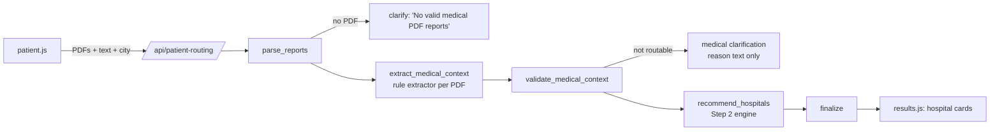
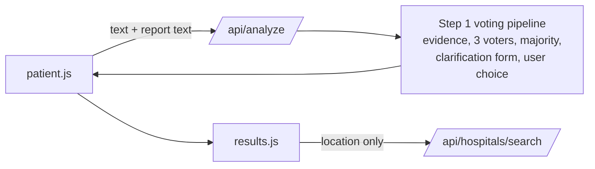
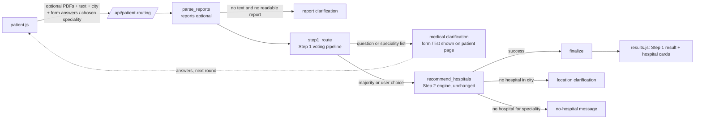

# Integrating Step 1 with Shubham's Step 2 workflow

**Date:** 2026-11-10 · **Branch:** `pravin` · **Inputs:** Shubham's commits `8b23800` (LangGraph
routing) and `699a723` (frontend integration) on `main`; Pravin's Step 1 voting pipeline (`269159a`).

## Contents

1. [Summary](#1-summary)
2. [Before: two halves that didn't meet](#2-before-two-halves-that-didnt-meet)
3. [After: one flow](#3-after-one-flow)
4. [What changed, file by file](#4-what-changed-file-by-file)
5. [How it was tested](#5-how-it-was-tested)
6. [Follow-ups](#6-follow-ups)

---

## 1. Summary

Shubham built the end-to-end orchestration: a LangGraph workflow behind one endpoint,
`POST /api/patient-routing` (reports + text + city → hospitals or a clarification), and a
frontend that uses it. Pravin built Step 1: a voting pipeline that turns the patient's words into
a suggested speciality. Each half worked alone; neither reached the other.

The integration keeps **Shubham's flow, endpoint and response** and replaces the medical step in
his graph with the Step 1 pipeline. Step 2 (`HospitalRecommendationEngine`) is unchanged.

## 2. Before: two halves that didn't meet

**Shubham's `main` (Step 12 workflow):**

- A PDF was **required**: typed text alone stopped at "No valid medical PDF reports were provided".
- The speciality came from the older **rule-based extractor** reading the PDF; the patient's typed
  text was not used to choose it.
- A clarification was a reason message only; there was no way to answer it in the flow.
- Code was on the old `src/Src/backend/...` layout, branched before the restructure.

**Pravin's `pravin` branch (Step 1):**

- Good speciality routing, but **Step 2 was never called**: the results page listed hospitals by
  location only.

## 3. After: one flow

| | Before (Shubham's `main`) | After (integrated on `pravin`) |
|---|---|---|
| Endpoint | `POST /api/patient-routing` | Same path, same multipart fields, same response fields; plus `step1` block and `workflow_id` |
| Reports | Required | Optional; typed text alone works |
| Medical step | `extract_medical_context` + `validate_medical_context` (rules) | One `step1_route` node: Step 1 voting pipeline on text + report text |
| Step 1 → Step 2 hand-off | `MedicalContext` from the rule extractor | `MedicalContext.primary_specialty` = suggested speciality; `procedures` / `diagnoses` from Step 1 evidence |
| Clarification | Reason text | Step 1's form (up to 2 rounds) and speciality list, answered on the patient page; rounds linked by `parent_request_id` |
| No hospital for a speciality | Medical clarification (asked again) | Ends with "no verified hospital yet" message |
| Step 2 | `HospitalRecommendationEngine.recommend` | Unchanged |
| Results page | Hospital cards; medical-context card removed | Hospital cards (Shubham's), plus the Step 1 result in the context card |
| Logs | Module logger | Every workflow node logs a `workflow:*` event with `workflow_id`; Step 1 stages log with their `request_id` (linked) in `logs/step1_trace.jsonl` |

The `/api/analyze` endpoint stays for Step 1 alone (evaluation, API reference).

## 4. What changed, file by file

| File (new layout) | From Shubham | Changed for the integration |
|---|---|---|
| `src/mediroute/backend/workflow/patient_routing_graph.py` | Graph shape, edges, END paths | Medical nodes replaced by `step1_route`; added `no_hospital_for_specialty` |
| `.../workflow/routing_nodes.py` | `parse_reports`, `recommend_hospitals`, location clarification, finalize, error | New `step1_route`; reports optional; clarification carries Step 1 type; logging per node; Step 1/Step 2 injected (for tests) and loaded lazily |
| `.../workflow/routing_decisions.py` | `decide_after_recommendation` | `decide_after_report_parsing` (text or report → route), `decide_after_step1`; `no_specialty_match` → no-hospital |
| `.../workflow/routing_state.py` | `top_k`, `report_files` | Step 1 inputs and result, `workflow_id`, `report_text` |
| `.../workflow/api.py` (new module) | Endpoint, upload limits (5 files, 10 MB each, 30 MB total, PDF signature), response fields | Optional reports; form fields for clarification answers, round, chosen speciality, parent request id; `step1` block; `workflow_id` |
| `src/mediroute/backend/main.py` | Swagger file-picker fix (nullable `files`) | Includes the workflow router |
| `src/mediroute/specialty_routing/step1/pipeline.py` | — | Response adds `evidence_detail` (evidence by kind) for Step 2 |
| `frontend/js/patient.js` | Endpoint call, double-submit guard, city map, error messages, routing view | One `runRouting()` per round; Step 1 form, speciality list and emergency notice on the page |
| `frontend/js/results.js` | Hospital cards, clarification card, ranking reasons | Context card shows the Step 1 result; "no verified hospital" card |
| `frontend/patient.html`, `results.html`, `hospital.*`, `results.css` | His changes | Three-way merged; Step 1 panels kept; context card wording |
| `tests/workflow/test_patient_routing_graph.py` | Scenarios of his Step 12 tests | Rewritten as pytest with fake Step 1/Step 2 (11 tests) |
| `data/raw/test_reports/*.pdf` | His synthetic reports | Moved from `Data/test_reports` |
| `pyproject.toml`, `requirements.txt` | — | `langgraph` added (it was used but not declared) |

Not ported: his `extract_medical_context` / `validate_medical_context` nodes (replaced by Step 1),
and his print-style test scripts (`test_step12e/f/g.py`), whose scenarios are covered by the new
pytest file.

## 5. How it was tested

- **Unit / graph tests:** 47 passed (Step 1 pipeline, workflow graph with fakes, existing tests).
- **API:** `python scripts/api_smoke_workflow.py`, 9 scenarios on 2026-11-10:

| Scenario | Workflow status | Step 1 | Step 2 |
|---|---|---|---|
| Text only: "Doctor advised CABG", Chennai | completed | Cardiothoracic Surgery | 2 hospitals (Apollo Greams Road, MIOT) |
| Text only: osteoarthritis, knee replacement | completed | Orthopaedics | 5 hospitals |
| PDF only: coronary artery disease report | completed | Cardiology | 5 hospitals |
| PDF + text: atrial fibrillation ECG | completed | Cardiology | 5 hospitals |
| PDF only: type 2 diabetes report | completed | Endocrinology | 2 hospitals |
| "weakness" | waiting_for_clarification | question (General Medicine majority) | — |
| … + bones and joints, "slipped disc L4-L5" | completed | Orthopaedics | 5 hospitals |
| "Cataract surgery" | no_hospital_for_specialty | Ophthalmology | no specialty match |
| "CABG", Kochi | waiting_for_clarification (location) | Cardiothoracic Surgery | no location match |
| Blank PDF, no text | waiting_for_clarification (report) | — | — |

- **Browser** (headless Chromium, patient page → results page): knee replacement in Bengaluru shows
  "Suggested speciality to search: Orthopaedics" and 5 ranked Bengaluru hospitals; "weakness" shows
  the form, and the answers lead to Orthopaedics hospitals; cataract shows the "no verified
  hospital" card. No console errors.
- **Tracing:** one call can be followed in `logs/step1_trace.jsonl`:
  `workflow:parse_reports` → Step 1 `input` … `decision` → `workflow:step1_route` (links the Step 1
  `request_id`) → `workflow:recommend_hospitals` (status, count, top hospitals) → `workflow:finalize`.

Time per call: about 15–30 s on a CPU laptop (Step 1's two LLM calls dominate; Step 2 adds about 1 s).

## 6. Follow-ups

1. **Point Step 2 at the verified master data.** Step 2 still searches the old 150-hospital index.
   Several specialities Step 1 can suggest have 0–2 hospitals there (Obstetrics & Gynaecology,
   Ophthalmology, ENT, Dermatology, Psychiatry, General Medicine: 0). Rebuild the FAISS index from
   `data/processed/master-hospital-data.csv` (tracker task 15).
2. **"How results are weighted" panel** on the results page shows fixed 60/20/20 weights from the
   mid-sem plan; they don't describe the current reranker. Replace with the real ranking criteria
   when AHP-TOPSIS (task 12) lands.
3. **Delhi NCR** is not sent as a city (Shubham's choice, to avoid inventing a city/state); decide
   how to map it once Step 2 uses the master data (New Delhi, Gurugram).
4. Shubham's branch `main` still has the old layout; once this is reviewed, `main` can be updated
   from `pravin`.
