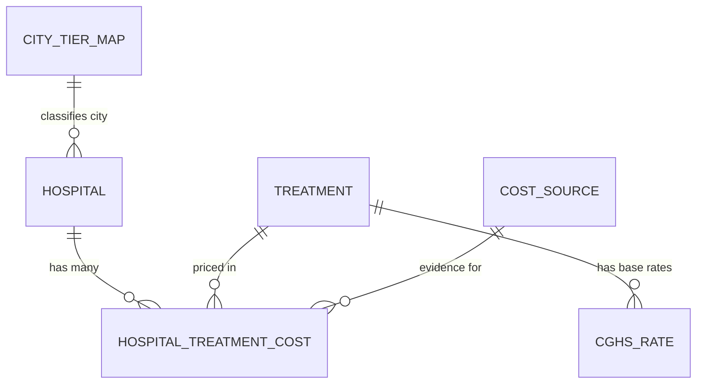
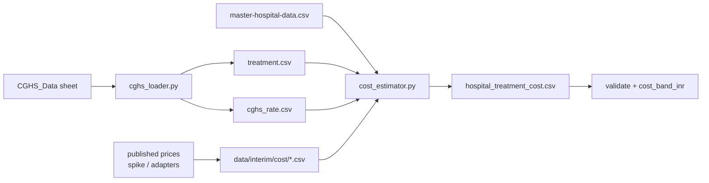

# Treatment cost data: design

**Status:** Draft for review (rev 2) · **Author:** Pravin (with Claude Code) · **Date:** 2026-11-06
**Depends on:** [master-hospital-data.csv](../../data/processed/master-hospital-data.csv),
[hospital.schema.csv](../../data/processed/hospital.schema.csv), and the `CGHS_Data` sheet in
[Hosp_Data_Final.xlsx](../../data/raw/data_generator/Hosp_Data_Final.xlsx)

**Changes in rev 2:**
- Scope cut to a minimum version first. The TA ranks cost as secondary to routing, ranking and
  evaluation, so scrapers are optional and come only after the spike.
- The estimate now **looks up** the CGHS rate for the hospital's tier and category instead of
  multiplying a Tier I rate. This is simpler and exact for the 19 codes that are flat across tiers.
- Fixed confidence: a CGHS rate is not a private hospital's price, so for private hospitals it is a
  lower bound, not "Medium" confidence.
- Fewer tables (5 instead of 6, no many-to-many factor link).
- Every open decision in §9 now has a recommended answer, so review can be yes/no.
- Added a proposed city → CGHS tier map for our 14 cities.

## Contents

1. [Goal and scope](#1-goal-and-scope)
2. [What the CGHS sheet already gives us](#2-what-the-cghs-sheet-already-gives-us)
3. [Where costs come from](#3-where-costs-come-from)
4. [Schema](#4-schema)
5. [Estimating a cost](#5-estimating-a-cost)
6. [Pipeline, modules and files](#6-pipeline-modules-and-files)
7. [Validation and calibration](#7-validation-and-calibration)
8. [How the app uses it](#8-how-the-app-uses-it)
9. [Decisions needed at review](#9-decisions-needed-at-review)
10. [Plan](#10-plan)

---

## 1. Goal and scope

For each hospital in the master list, give an **indicative cost range in INR** for common
medical-travel treatments. Every number says where it came from and how confident we are.

1. Use a price the hospital **publishes**, wherever one exists.
2. Otherwise **estimate** it from the CGHS rate schedule, adjusted for ward type and a calibrated
   private-market factor.

Costs are **display only** (architecture stage 2.4). They do not affect ranking.

**Minimum version (do first):** CGHS loader + estimates for the reference basket (§3) for all 100
hospitals, clearly labelled as estimates. **Extension (only if time allows and the spike shows
coverage):** published-price adapters and market-factor calibration.

Out of scope: insurance, live quotes, currency conversion (can be added at display time).

## 2. What the CGHS sheet already gives us

Profiled from the `CGHS_Data` sheet, 5,994 rows:

| Fact | Value |
|------|-------|
| Distinct CGHS codes | 1,998, each repeated for Tier I, II and III cities (3 × 1,998 rows) |
| Rate columns | Non-NABH, NABH, Super Speciality. All rates are for a **semi-private ward** |
| Code families (prefix) | `LB` lab 1,005 rows, `CA` oncology investigations 504, `NU` nephro-urology 504, `RI` radiology 441, `OP` ophthalmology 435, `OR` orthopaedics 381, `DP` dental 333, `NS` neurosurgery 264, `CV` cardiac surgery 120 … |
| `Speciality Classification` | 60 labels, e.g. "Surgery Procedure Cardiovascular And Cardiac" |

Patterns **measured in the data** (used as loader checks, see §7):

| Pattern | Measured | Coverage |
|---------|----------|----------|
| Tier II ÷ Tier I | 0.90 | 1,979 of 1,998 codes (19 codes are flat) |
| Tier III ÷ Tier I | 0.80 | 1,979 of 1,998 codes |
| Non-NABH ÷ NABH | 0.85 | ~4,476 rows; 60 rows are flat |
| Super Speciality ÷ NABH | 1.15 | 482 codes, almost all surgical procedures, never investigations |

Data-quality issues to clean when loading:

- 230 codes have slightly different names across the three tier rows. Keep the Tier I name.
- Some classification labels differ only by case or wording ("ENT investigation" vs "ENT
  Investigation", "Procedure" vs "Procedures").
- The header spans two rows.
- Some descriptions carry conditions ("cost of implant only", "cost of drug extra"). Keep these as
  a `price_notes` field.

CGHS rates are **reimbursement ceilings for government beneficiaries**, not market prices. A
private hospital usually charges a self-paying or international patient more. The market factor
in §5 covers that gap.

## 3. Where costs come from

Source research (2026-11-06) is in [cost_source_research.md](cost_source_research.md): no hospital
publishes usable package prices; MediGence is the one aggregator with per-hospital prices that
allows automated access; CGHS rules are confirmed.

Each cost row records its `cost_basis`. When several exist, the app shows the highest-ranked one.

| Rank | Source | `cost_basis` | Notes |
|------|--------|--------------|-------|
| 1 | **Hospital's own published price** (package / cost pages on the official site, URL already in the master) | `published_hospital` | Most specific. Expected for few hospitals; many only offer an enquiry form |
| 2 | **Government institute user charges** (AIIMS, PGIMER, state hospitals) | `government_published` | Only for our 12 government hospitals, where it *is* their price |
| 3 | **CGHS estimate** with the model in §5 | `derived_cghs` | Always available fallback. Shown as an estimate |

Used as **inputs or checks**, not shown as a hospital's price:

- **NPPA implant ceilings** (coronary stents, knee implants): added to CGHS-based estimates where
  CGHS says "implant extra".
- **PM-JAY package rates:** a sanity lower bound only.
- **Medical-travel aggregators:** not official. Calibration only, and only if the site's terms
  allow it (decision 5).

**Feasibility spike (before any scraper):** 10 hospitals (mixed cities and ownership) × 10 basket
treatments. Search manually for rank 1–2 prices, record what was found and where. Build an adapter
only for a source that covers a useful share of rows.

**Reference basket** (17 treatments, to confirm): CABG · coronary angioplasty with one stent ·
valve replacement · total knee replacement · total hip replacement · spinal fusion · kidney
transplant · liver transplant · cataract (phaco + IOL) · IVF cycle (no CGHS code; published only) ·
lap cholecystectomy · hysterectomy · TURP · craniotomy for tumour · chemotherapy cycle ·
radiotherapy course · bone marrow transplant.

## 4. Schema



Five files in `data/processed/`:

### 4.1 `treatment.csv` (one row per treatment)

| Column | Required | Example | Notes |
|--------|----------|---------|-------|
| `treatment_id` | yes | `T0001` | Stable ID |
| `cghs_code` | no | `CV027` | Blank when there is no CGHS code (IVF) |
| `treatment_name` | yes | Heart Transplant Surgery | Tier I CGHS name, cleaned |
| `canonical_specialty` | yes | Cardiothoracic Surgery | Same vocabulary as `verified_specialties` in the master (depends on Step 1 task 9, the canonical specialty list) |
| `treatment_type` | yes | procedure \| investigation \| consultation \| therapy \| package | From code family and classification |
| `in_reference_basket` | yes | true | |
| `price_notes` | no | "implant extra" | From the CGHS description |

### 4.2 `cghs_rate.csv` (long format)

One row per `cghs_code` × `city_tier` × `hospital_category` (non_nabh \| nabh \| super_speciality),
≈ 18k rows. Columns: `cghs_code, city_tier, hospital_category, rate_inr, schedule_version`.
All rates are semi-private ward.

### 4.3 `hospital_treatment_cost.csv` (one hospital → many costs)

| Column | Required | Example | Notes |
|--------|----------|---------|-------|
| `hospital_id` | yes | `H021` | FK to master |
| `treatment_id` | yes | `T0412` | FK to `treatment.csv` |
| `ward_type` | yes | general \| semi_private \| private | |
| `cost_min_inr` / `cost_max_inr` | yes | 180000 / 260000 | A single published price has min = max |
| `cost_basis` | yes | published_hospital \| government_published \| derived_cghs | |
| `source_id` | yes | `SRC-CGHS` | FK to `cost_source.csv` |
| `source_url` | no | | Page the number came from |
| `retrieved_on` | yes | 2026-11-06 | |
| `confidence` | yes | High \| Medium \| Low | published = High; derived = Low until calibrated, Medium after |
| `factors_applied` | derived rows | `tier=II;cat=nabh;ward=1.0;market=2.2` | Lets anyone re-compute the number |
| `notes` | no | "implant extra" | |

**Key:** (`hospital_id`, `treatment_id`, `ward_type`, `cost_basis`).
**Volume:** store only basket rows: 17 × 100 × 3 wards ≈ 5k rows, plus any published rows. Other
treatments are computed on request from `cghs_rate`.

### 4.4 `cost_source.csv` and `city_tier_map.csv`

- `cost_source.csv`: `source_id, name, url, authority (official|unofficial), retrieved_on`.
- `city_tier_map.csv`: `city, cghs_city_tier, evidence` (proposal in decision 2).

Ward and market factor values live in a small constants block in `cost_estimator.py`, each with a
comment citing its evidence. A separate factor table is not needed at this size.

### 4.5 `cost_band_inr` in the master

Filled from `hospital_treatment_cost`: the median ratio of the hospital's basket estimates to its
city's median, as a label: `Economy` (< 0.85), `Standard` (0.85–1.15), `Premium` (> 1.15).

## 5. Estimating a cost

For hospital *h*, treatment *t*, ward *w*:

```
rate      = cghs_rate[ code(t), cghs_city_tier(h.city), category(h, t) ]   lookup
estimate  = rate × f_ward(w, t) × f_market(h)
range     = [estimate × (1 − u), estimate × (1 + u)]                      u = 0.25 until calibrated
```

`category(h, t)`:
- `super_speciality` if the hospital is super-speciality (decision 3) **and** CGHS gives the code a
  super-speciality rate,
- else `nabh` if `nabh_status = Accredited` or the hospital is JCI-accredited (decision 4),
- else `non_nabh`.

| Factor | Value | Status |
|--------|-------|--------|
| `f_ward` | general 0.95 · semi-private 1.00 · private 1.05; packages only (investigations, consultations, radiotherapy unchanged) | **Confirmed**: CGHS rules effective 13 Oct 2025 ([research §2.4](cost_source_research.md#24-government-and-regulated-sources)) |
| `f_market` | Private Tier 1: 2.5 · Private Tier 2: 1.8 · Trust / deemed university: 1.4 · Government: 1.0 (but rank 2 user charges replace it where found) | **Starting assumption.** Calibrated if the spike finds enough published prices (§7) |

Where CGHS says "implant extra", add the NPPA ceiling if available; otherwise keep "implant extra"
in `notes` so the estimate is not silently low.

## 6. Pipeline, modules and files



| Module (`src/mediroute/data_generator/`) | Does |
|------------------------------------------|------|
| `cghs_loader.py` | Read the sheet, fix the header, clean names and labels, map to specialties, write `treatment.csv` + `cghs_rate.csv` |
| `cost_estimator.py` | Published prices first, then derived basket rows; record `factors_applied`; validate; fill `cost_band_inr` |
| `price_sources/` (extension) | One adapter per source that passed the spike; output to `data/interim/cost/` |

Schema goes in `data/processed/cost.schema.csv`, like `hospital.schema.csv`.

## 7. Validation and calibration

- **Schema checks:** FKs exist, min ≤ max, allowed values, unique key, `factors_applied` on derived
  rows.
- **Loader check:** the loaded rates must reproduce the measured patterns in §2 (0.90, 0.80, 0.85,
  1.15). This catches parsing errors.
- **Sanity rules:** a government hospital's estimate is not above a private Tier 1 hospital's in
  the same city; investigations never get the super-speciality rate.
- **Calibration (extension):** for each published price with a CGHS match, compute
  `published ÷ (rate × f_ward)`. Take the median per Hospital_Tier × ownership as `f_market`, and
  its spread as `u`. Hold out 20% and report the median absolute percentage error. If it is large,
  show derived costs only as the band label, not as numbers.

## 8. How the app uses it

- Step 2.4 shows, per recommended hospital, the cost range for the treatment matched in Step 1,
  with its basis and confidence, e.g. *"₹1.8–2.6 L · estimated from CGHS rates · low confidence"*.
- Published prices show their source link and date.
- Standing disclaimer: indicative only, not a quote; confirm with the hospital.

## 9. Decisions needed at review

Each has a recommended answer; reply "agree" or give the alternative.

| # | Decision | Recommended |
|---|----------|-------------|
| 1 | Reference basket | The 17 treatments in §3 |
| 2 | City → CGHS tier | Use the CGHS / HRA city classes, not the team's `City_Tier`. **Tier I** New Delhi, Gurugram (takes Delhi rates per the CGHS/ECHS addendum), Mumbai, Navi Mumbai, Chennai, Kolkata, Bengaluru, Hyderabad, Ahmedabad, Pune · **Tier II** Chandigarh (incl. Mohali, Panchkula per the addendum), Nagpur, Kochi, Visakhapatnam. Pune, Kochi and Visakhapatnam still to confirm ([research §3](cost_source_research.md#3-corrections-to-the-design)) |
| 3 | Super-speciality hospital rule | CGHS definition: ≥ 200 beds, NABH or JCI accredited, offers the listed super-specialities. Without bed counts in the master: accredited (NABH or JCI) **and** `hospital_type` contains "quaternary" |
| 4 | JCI but no NABH certificate (the six Apollo flagships) | Use the NABH rate |
| 5 | Aggregator prices | Research found MediGence (per-hospital USD "starting from" prices, `robots.txt` allows) is the only usable one. Recommended: show it as a separate "reported by MediGence" line with Low confidence, after a teammate reads its terms; also use it for calibration ([research §3](cost_source_research.md#3-corrections-to-the-design)) |
| 6 | `cost_band_inr` format | Band label (Economy / Standard / Premium) |
| 7 | Store vs compute | Store basket rows only |
| 8 | Costs in ranking? | No, display only (TA: medical fit first) |

## 10. Plan

| Step | Output | Effort |
|------|--------|--------|
| 0. Review, take the decisions in §9 | Updated design | 0.5 day |
| 1. `cghs_loader.py` + loader check | `treatment.csv`, `cghs_rate.csv` | 1 day |
| 2. `cost_estimator.py` with starting factors, city tier map, schema | `hospital_treatment_cost.csv`, `cost_band_inr` filled | 1 day |
| 3. Feasibility spike: 10 hospitals × 10 treatments, manual | Coverage table per source | 0.5–1 day |
| 4. *(If the spike finds enough prices)* adapters + calibration | Calibrated `f_market`, hold-out report | 1–3 days |

Steps 1–2 give a complete, labelled minimum version. Steps 3–4 improve accuracy.
