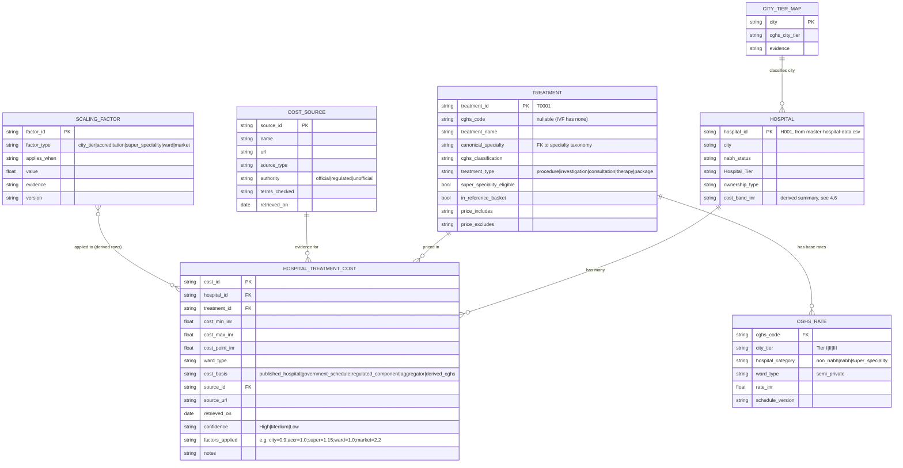
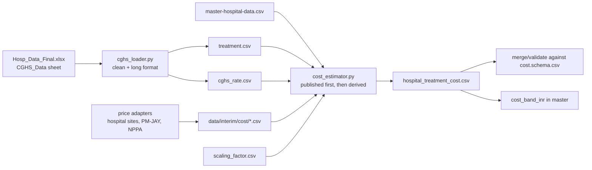

# Treatment cost data: design

**Status:** Draft for review · **Author:** Pravin (with Claude Code) · **Date:** 2026-11-05
**Depends on:** [master-hospital-data.csv](../../data/processed/master-hospital-data.csv),
[hospital.schema.csv](../../data/processed/hospital.schema.csv), and the `CGHS_Data` sheet in
[Hosp_Data_Final.xlsx](../../data/raw/data_generator/Hosp_Data_Final.xlsx)

## Contents

1. [Goal](#1-goal)
2. [What the CGHS sheet already gives us](#2-what-the-cghs-sheet-already-gives-us)
3. [Where costs come from (source strategy)](#3-where-costs-come-from-source-strategy)
4. [Schema (one hospital to many treatment costs)](#4-schema-one-hospital-to-many-treatment-costs)
5. [Estimating a cost from CGHS (scaling model)](#5-estimating-a-cost-from-cghs-scaling-model)
6. [Pipeline, modules and files](#6-pipeline-modules-and-files)
7. [Validation and calibration](#7-validation-and-calibration)
8. [How the app uses it](#8-how-the-app-uses-it)
9. [Decisions needed at review](#9-decisions-needed-at-review)
10. [Plan](#10-plan)

---

## 1. Goal

For each hospital in the master list, give an **indicative cost range in INR for the treatments a
patient is likely to need**. Every number must say where it came from and how confident we are.

The approach:

1. Use a price the hospital or a government body **publishes**, wherever one exists.
2. Otherwise **estimate** the price from the CGHS rate schedule, scaled by city tier, accreditation,
   super-speciality status, ward type and a calibrated private-market factor.

Costs are for **display only** (architecture stage 2.4). They are not used to rank hospitals unless
the team decides otherwise (see [section 9](#9-decisions-needed-at-review)).

Out of scope: insurance coverage, live quotes and currency conversion. Currency conversion can be
added at display time.

## 2. What the CGHS sheet already gives us

Profiled from the `CGHS_Data` sheet, 5,994 rows:

| Fact | Value |
|------|-------|
| Distinct CGHS codes | 1,998, each repeated for Tier I, II and III cities (3 × 1,998 rows) |
| Rate columns | Non-NABH, NABH, Super Speciality. All rates are for a **semi-private ward** |
| Code families (prefix) | `LB` lab 1,005 rows, `CA` oncology investigations 504, `NU` nephro-urology 504, `RI` radiology 441, `OP` ophthalmology 435, `OR` orthopaedics 381, `DP` dental 333, `NS` neurosurgery 264, `CV` cardiac surgery 120 … |
| `Speciality Classification` | 60 labels, e.g. "Surgery Procedure Cardiovascular And Cardiac", "Orthopaedics Procedure" |

Multipliers **measured in the data**:

| Factor | Measured | Coverage |
|--------|----------|----------|
| Tier II ÷ Tier I | **0.90** | 1,979 of 1,998 codes (19 codes are the same in every tier) |
| Tier III ÷ Tier I | **0.80** | 1,979 of 1,998 codes |
| Non-NABH ÷ NABH | **0.85** (shown as NABH/Non-NABH ≈ 1.18) | ~4,476 rows; 60 rows are flat |
| Super Speciality ÷ NABH | **1.15** | 482 codes (Tier I), almost all surgical procedures: nephro-urology, GI surgery, neurosurgery, cardiac, paediatric surgery. Never investigations |

Data-quality issues to clean when loading:

- 230 codes have slightly different procedure names across the three tier rows. Keep the Tier I
  name as canonical.
- Some classification labels differ only by case or wording ("Behavioural therapy" vs
  "Behavioural Therapy", "ENT investigation" vs "ENT Investigation", "Procedure" vs "Procedures").
- Heading rows span two lines (the rate header covers three columns).
- Some descriptions carry conditions, e.g. "cost of implant only" or "cost of drug extra". Keep
  these as a `price_includes` / `price_excludes` note.

CGHS rates are **reimbursement ceilings for government beneficiaries**, not market prices. A
private hospital's price for a self-paying patient, or a medical traveller, is usually higher. That
gap is what the market factor in [section 5](#5-estimating-a-cost-from-cghs-scaling-model) has to
capture.

## 3. Where costs come from (source strategy)

Try each source in order of authority. Each cost row records which kind of source it came from
(`cost_basis`), so the most authoritative one available wins.

| Rank | Source | `cost_basis` | Coverage expected | Notes |
|------|--------|--------------|-------------------|-------|
| 1 | **Hospital's own published package price**: "packages", "cost of treatment" or "price estimate" pages on the official website (URL already in the master) | `published_hospital` | Low (10–25% of hospitals, a few procedures each) | Most specific. Scrape with a per-site adapter, as was done for NABH. Many hospitals only offer an enquiry form, so they're recorded as "not published" |
| 2 | **Government schedules**: CGHS (have it), the [PM-JAY Health Benefit Package](https://pmjay.gov.in/) rates (National Health Authority), and user-charge lists of government institutes (AIIMS, PGIMER) | `government_schedule` | High for procedures; government hospitals directly | Official and public. PM-JAY packages are bundled and priced lower than CGHS. Useful as a lower bound |
| 3 | **Regulated implant prices**: [NPPA](https://www.nppaindia.nic.in/) ceiling prices for coronary stents and knee implants | `regulated_component` | A few high-value procedures | Lets an angioplasty or knee-replacement estimate add the implant correctly |
| 4 | **Medical-travel aggregators**: indicative per-hospital package ranges | `aggregator` | Medium for popular procedures | **Not official.** Check each site's terms before collecting. Use only for calibration and as low-confidence ranges |
| 5 | **Derived from CGHS** with the scaling model | `derived_cghs` | 100% (every hospital × every CGHS code) | Always available fallback. Must show it is an estimate |

**Feasibility spike (first step, before building scrapers):**

1. Take 10 hospitals (mixed tiers and cities) and a basket of 10 common medical-travel procedures.
2. Look manually for rank 1–4 prices and note where each one was found.
3. Record coverage per source.
4. Build scrapers only for sources that cover enough rows.

The aim is not to spend effort scraping sites that publish nothing.

**Reference basket** (proposed, to be confirmed). These are high-volume medical-travel treatments,
mapped to CGHS codes during loading:

CABG · coronary angioplasty with one stent · valve replacement · total knee replacement · total hip
replacement · spinal fusion · kidney transplant · liver transplant · cataract (phaco + IOL) · IVF
cycle (no CGHS code; published or aggregator only) · lap cholecystectomy · hysterectomy · TURP ·
craniotomy for tumour · chemotherapy cycle · radiotherapy course · bone marrow transplant.

## 4. Schema (one hospital to many treatment costs)



### 4.1 `treatment.csv`: treatment catalogue (one row per treatment)

| Column | Type | Required | Allowed / example | Notes |
|--------|------|----------|-------------------|-------|
| `treatment_id` | string | yes | `T0001` | Stable ID |
| `cghs_code` | string | no | `CV027` | Blank for treatments with no CGHS code (e.g. IVF) |
| `treatment_name` | string | yes | Heart Transplant Surgery | Tier I name from CGHS, cleaned |
| `canonical_specialty` | string | yes | Cardiothoracic Surgery | Mapped with `data/medical_taxonomy/specialty_normalization.csv`, the same vocabulary as `verified_specialties` in the hospital master |
| `cghs_classification` | string | no | Surgery Procedure Cardiovascular And Cardiac | Cleaned label |
| `treatment_type` | category | yes | procedure \| investigation \| consultation \| therapy \| package | From code family and classification |
| `super_speciality_eligible` | bool | yes | true | true when CGHS gives the 1.15× uplift |
| `in_reference_basket` | bool | yes | true | Medical-travel basket ([section 3](#3-where-costs-come-from-source-strategy)) |
| `price_includes` / `price_excludes` | string | no | "cost of implant extra" | Taken from the CGHS description |

### 4.2 `cghs_rate.csv`: base rates (long format, many per code)

One row per `cghs_code` × `city_tier` × `hospital_category`: 1,998 × 3 × 3 ≈ 18k rows. Columns:
`cghs_code, city_tier, hospital_category, ward_type (=semi_private), rate_inr, schedule_version,
source_id`.

### 4.3 `hospital_treatment_cost.csv`: the one-to-many table

One hospital has many rows: one per treatment, ward type and cost basis.

| Column | Type | Required | Allowed / example | Notes |
|--------|------|----------|-------------------|-------|
| `cost_id` | string | yes | `C000001` | |
| `hospital_id` | string | yes | `H021` | FK to `master-hospital-data.csv` |
| `treatment_id` | string | yes | `T0412` | FK to `treatment.csv` |
| `ward_type` | category | yes | general \| semi_private \| private | |
| `cost_min_inr` / `cost_max_inr` | number | yes | 180000 / 260000 | A range. A single published price has min = max |
| `cost_point_inr` | number | no | 220000 | Best single estimate |
| `cost_basis` | category | yes | published_hospital \| government_schedule \| regulated_component \| aggregator \| derived_cghs | |
| `source_id` | string | yes | `SRC-CGHS-2014` | FK to `cost_source.csv` |
| `source_url` | url | no | | Page the number came from |
| `retrieved_on` | date | yes | 2026-11-05 | |
| `confidence` | category | yes | High \| Medium \| Low | published = High, government/regulated = Medium, aggregator or derived = Low until calibrated |
| `factors_applied` | string | for derived | `city=1.0;accr=1.0;super=1.15;ward=1.0;market=2.2` | Lets anyone re-compute the number |
| `notes` | string | no | "implant extra" | |

**Uniqueness:** (`hospital_id`, `treatment_id`, `ward_type`, `cost_basis`). Several bases can sit
side by side for the same treatment. The app shows the best available (`published_hospital` >
`government_schedule` > `aggregator` > `derived_cghs`) and can show the others for comparison.

**Volume:** storing derived rows for every hospital × every code would be 100 × 1,998 × 3 wards ≈
600k rows. Recommendation: **store only the reference basket** (about 17 treatments × 100 hospitals
× 3 wards ≈ 5k rows) plus all non-derived rows. Compute other derived costs on request from
`cghs_rate` + `scaling_factor`.

### 4.4 `cost_source.csv` and 4.5 `scaling_factor.csv`

Small registries, so every number can be traced and every assumption is versioned. A factor row
looks like this:
`F-CITY-T2, city_tier, "cghs_city_tier = Tier II", 0.90, "measured in CGHS sheet: 1,979/1,998 codes", v1`.

### 4.6 `cost_band_inr` in the hospital master

The master already has a `cost_band_inr` column, currently `NA`. Proposal: fill it **from
`hospital_treatment_cost`** as a band label for the reference basket, using the median ratio of the
hospital's basket cost to the city's median:

- `Economy`: below 0.85× the city median
- `Standard`: 0.85–1.15×
- `Premium`: above 1.15×

The hospital table stays one row per hospital, and the detail lives in the child table. This is
listed in [section 9](#9-decisions-needed-at-review) for decision.

## 5. Estimating a cost from CGHS (scaling model)

For a hospital *h*, treatment *t* and ward *w*:

```
base        = CGHS rate for code(t) at Tier I, NABH, semi-private
estimate    = base
            × f_city(cghs_city_tier(h.city))                     0.90 / 0.80, measured
            × f_accreditation(h.nabh_status)                     1.00 NABH, 0.85 non-NABH, measured
            × f_super(h is super-speciality AND t eligible)      1.15, measured
            × f_ward(w)                                          general / semi-private / private
            × f_market(h.Hospital_Tier, h.ownership_type, t.treatment_type)   calibrated
range       = [estimate × (1 − u), estimate × (1 + u)]           u from calibration error
```

| Factor | Value | Status |
|--------|-------|--------|
| `f_city` | Tier I 1.00 · Tier II 0.90 · Tier III 0.80 | **Measured** in the sheet. Needs a `city → CGHS city tier` map ([section 9](#9-decisions-needed-at-review)): the CGHS tier is not the same as the team's `City_Tier` |
| `f_accreditation` | NABH 1.00 · non-NABH 0.85 | **Measured.** NABH `Accredited` → NABH rate. `Needs verification` / `Not found` → non-NABH, unless JCI-accredited (decision needed) |
| `f_super` | 1.15 for the 482 eligible codes | **Measured.** "Super-speciality hospital" needs a rule. Proposal: `hospital_type` contains "quaternary" or "super", or Hospital_Tier = Tier 1 |
| `f_ward` | general 0.95 · semi-private 1.00 · private 1.05 (procedures only; investigations unchanged) | **Assumed** from the commonly cited CGHS ward rule. **Verify against the current CGHS office memorandum** before use |
| `f_market` | Starting guesses: Tier 1 private 2.0–3.0 · Tier 2 private 1.5–2.0 · trust 1.2–1.6 · government 0.3–1.0 (user charges) | **Assumption, to be calibrated** ([section 7](#7-validation-and-calibration)). This is the factor that matters most and is least known |

Implants and drugs marked "extra" in CGHS are added from `regulated_component` rows (NPPA ceiling)
where available. Otherwise the note "implant extra" is carried through, so the estimate is not
silently low.

## 6. Pipeline, modules and files



| Module (`src/mediroute/data_generator/`) | Responsibility |
|------------------------------------------|----------------|
| `cghs_loader.py` | Read the sheet, fix the two-row header, use Tier I names as canonical, clean labels, map to specialty taxonomy, write `treatment.csv` + `cghs_rate.csv` |
| `price_sources/` (one adapter per source) | Collect published or government prices into `data/interim/cost/<source>.csv` with URL and date. Same politeness rules as the NABH scraper |
| `cost_estimator.py` | Build `hospital_treatment_cost.csv`: real prices first, derived rows for the basket, `factors_applied` recorded |
| `merge_cost.py` | Validate against `data/processed/cost.schema.csv` (same approach as `merge_master.py`) and refresh `cost_band_inr` |

| Path | Contents |
|------|----------|
| `data/raw/cost/` | Downloaded official schedules (PM-JAY, NPPA, CGHS PDFs) as retrieved |
| `data/interim/cost/` | Per-source extracted prices, calibration report |
| `data/processed/treatment.csv`, `cghs_rate.csv`, `hospital_treatment_cost.csv`, `cost_source.csv`, `scaling_factor.csv` | Final tables |
| `data/processed/cost.schema.csv` | Column-level schema, like `hospital.schema.csv` |

## 7. Validation and calibration

- **Schema checks:** FKs exist (`hospital_id` in master, `treatment_id` in catalogue), min ≤ point
  ≤ max, allowed values, unique key, `factors_applied` present for derived rows.
- **CGHS reproduction test:** the loader must reproduce the measured multipliers (0.90, 0.80, 0.85,
  1.15). This catches parsing errors.
- **Market-factor calibration:** for every (hospital, treatment) pair that has a published or
  aggregator price and a CGHS base, compute `observed ÷ CGHS-adjusted base`. Fit `f_market` per
  Hospital_Tier × ownership (median) and report its spread. Use that spread as the range half-width
  `u`. Re-run whenever new published prices arrive. Document the fitted values in
  `scaling_factor.csv` with `evidence = "calibrated on N prices"`.
- **Hold-out check:** keep 20% of real prices aside, predict them with the model, and report the
  median absolute percentage error in the calibration report. If the error is large, show derived
  costs only as a band, not a number.
- **Sanity rules:** a government hospital's price must not be above the same city's private Tier 1
  price for the same treatment. Investigations are never super-speciality-scaled.

## 8. How the app uses it

- Step 2.4 shows, per recommended hospital, the cost range for the treatment matched in Step 1.4
  (CGHS procedures are already the "candidate procedures" there). It also shows the basis and
  confidence, e.g. *"₹1.8–2.6 L · estimated from CGHS rates · low confidence"*.
- Published prices are shown with their source link and date.
- A standing disclaimer: indicative costs, not a quote; confirm with the hospital.

## 9. Decisions needed at review

1. **Reference basket:** confirm the ~17 treatments in [section 3](#3-where-costs-come-from-source-strategy)
   (add or remove).
2. **City → CGHS city tier map:** the CGHS tier (I/II/III) differs from the team's `City_Tier`. Use
   the official CGHS classification of our 14 cities (to look up and cite), or reuse `City_Tier`?
3. **Super-speciality hospital rule:** which master fields decide `f_super`?
4. **Accreditation fallback:** a hospital with JCI but no NABH hospital certificate (the six Apollo
   flagships): NABH or non-NABH rate?
5. **Aggregator prices:** allowed for calibration only, also shown to users, or not used?
6. **`cost_band_inr`:** band label (Economy / Standard / Premium), a numeric basket range, or both?
7. **Store vs compute:** store only basket rows (recommended) or materialise everything?
8. **Do costs affect ranking** (an AHP criterion), or are they display only?

## 10. Plan

| Step | Output | Effort |
|------|--------|--------|
| 0. Review this design, take the decisions in §9 | Updated design | 0.5 day |
| 1. Feasibility spike: 10 hospitals × 10 basket procedures, manual source search | Coverage table per source | 0.5–1 day |
| 2. `cghs_loader.py` + `cost.schema.csv` + reproduction test | `treatment.csv`, `cghs_rate.csv` | 1 day |
| 3. City-tier map + scaling factors v1 | `scaling_factor.csv`, `city_tier_map.csv` | 0.5 day |
| 4. Adapters for sources that passed the spike (PM-JAY, NPPA, hospital pages) | `data/interim/cost/*` | 1–3 days |
| 5. `cost_estimator.py` + calibration + hold-out report | `hospital_treatment_cost.csv`, calibration report | 1–2 days |
| 6. `merge_cost.py`, `cost_band_inr` in master, README section | Validated tables, docs | 0.5 day |
